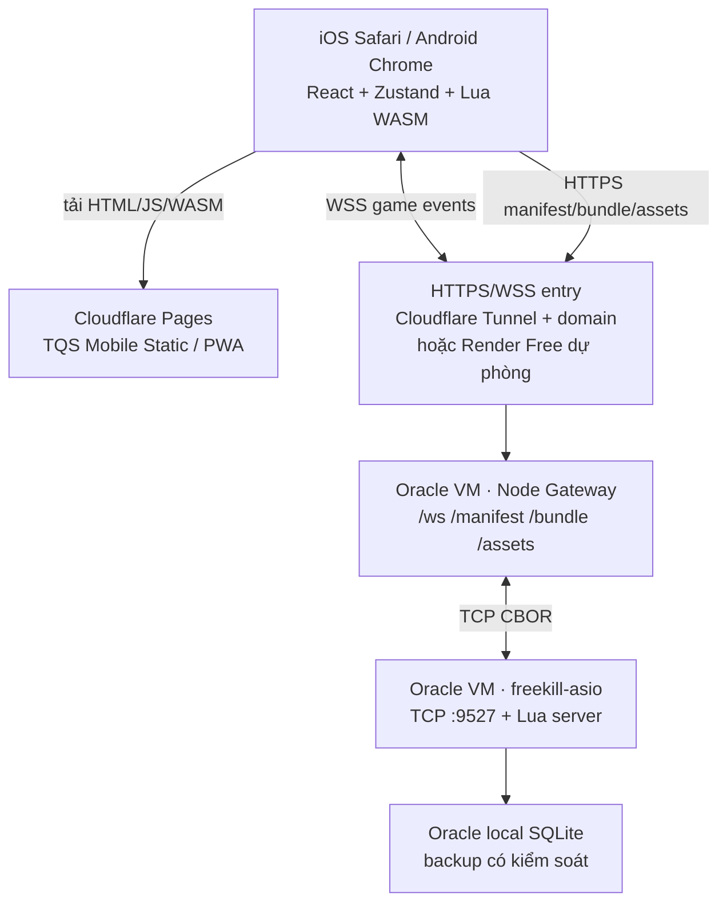

# TQS Mobile — Kế hoạch thực thi từ mã nguồn hiện tại đến chơi Quốc Chiến trên điện thoại

> **Ngày lập:** 09/10/2026 · **Trạng thái:** kế hoạch đã thống nhất về kiến trúc, **chưa phải báo cáo hệ thống chạy được**.
>
> **Tài liệu kiến trúc gốc:** [WEB_CLIENT_PLAN.md](./WEB_CLIENT_PLAN.md).
>
> **Mục tiêu ưu tiên:** người chơi mở đường dẫn HTTPS trên iOS Safari/Android Chrome, đăng nhập, tạo/vào phòng `new_heg_mode`, chọn hai tướng, đánh bài/dùng kỹ năng, chơi hết một ván với bot hoặc người khác, xem kết quả và kết nối lại sau gián đoạn.
> **Nguyên tắc:** tận dụng C++ FreeKill server + Lua hiện có; chỉ xây giao diện web/mobile; **không thay đổi TQSShop**. Chi phí vận hành kỳ vọng 0 đồng trong hạn mức các dịch vụ, nhưng phải theo dõi quota thực tế.

## 0. Quyết định đã chốt, phạm vi và cách đo “chơi được”

### 0.1. Quyết định kỹ thuật

| Hạng mục | Quyết định | Điều kiện cần xác nhận khi chạy thực tế |
|---|---|---|
| Luật và trạng thái game | FreeKill C++/Lua server vẫn là nguồn sự thật; không port luật sang TypeScript | Hành vi của server và gói package đã pin phải được đối chiếu với bản native |
| Lua client | Giữ hướng **Wasmoon + Lua 5.4 WASM**, viết adapter C++/Qt tối thiểu | **Chưa chứng minh tương thích hoàn chỉnh**: phải qua Gate G1/G2 trước khi xây UI sâu |
| Giao diện | React + TypeScript + Zustand, touch-first, tiếng Việt `vi_VN` mặc định | Không ép người dùng dùng client Qt/QML |
| Server game | Oracle Always Free VM hiện có, FreeKill TCP `9527`, dữ liệu SQLite giữ ở Oracle | Kiểm tra lại trạng thái server hiện tại trước bài test trực tiếp |
| WebSocket Gateway chính | Node.js Gateway đặt **cùng Oracle VM**, TCP tới `127.0.0.1:9527` | Phải có WSS/HTTPS công khai hợp lệ và giới hạn tài nguyên |
| Static frontend | **Cloudflare Pages** (`*.pages.dev`) | Bundle WASM, bản React phải build thành công; lưu ý file tĩnh tối đa 25 MiB/file trên Free |
| Truy cập WSS chính | **Cloudflare Tunnel** xuất bản Gateway qua hostname riêng nếu đã có domain trên Cloudflare | **Public hostname của Tunnel yêu cầu domain**; không coi `trycloudflare.com` là địa chỉ production |
| Không có domain | Thử **Render Free Web Service** làm Gateway `*.onrender.com`, hoặc hostname DNS miễn phí + reverse proxy TLS trên Oracle sau khi xác minh | Render ngủ sau 15 phút không có HTTP/WebSocket message đến; cold start/restart phải xử lý |
| Vai trò Render lâu dài | **Canary/benchmark** hoặc gateway dự phòng; có thể host Static Site khi cần | Không chuyển dữ liệu SQLite hay game server chính sang Render Free |
| Đồng bộ tài nguyên | Client tải **snapshot package trùng phiên bản server** (`manifest`, Lua bundle, ảnh/âm thanh) | Không có trường hợp manifest MD5 của bản A nhưng bundle của bản B |

### 0.2. Phân tầng sản phẩm

**MVP-A — bản chơi được sớm nhất (P0):** đăng nhập, sảnh, tạo phòng Quốc Chiến 2 người, thêm một bot, chọn tướng chính/phó, thực hiện các thao tác ra bài/phản hồi cơ bản, chơi đến `GameOver` trên điện thoại; trạng thái UI và lỗi được hiển thị rõ ràng. Chỉ làm đủ dialog cần cho các trận nghiệm thu, chưa ưu tiên hiệu ứng nghệ thuật.

**MVP-B — bản mời bạn bè (P1):** hai thiết bị thật vào cùng phòng; xử lý đầy đủ các tương tác gặp trong gói `hegemony` đang bật, reconnect thực tế, giao diện thích nghi với điện thoại phổ biến, tải/caching tài nguyên, chống treo nếu Lua báo lỗi.

**V1 — bản sử dụng ổn định (P2):** đa dạng kỹ năng/tướng, spectator/chat/replay nếu upstream hỗ trợ, hình ảnh và animation nâng cao, quản trị vận hành, tối ưu asset, công cụ đo hiệu năng và Render canary. Không đưa P2 lên đường găng đến trận game đầu tiên.

**Tiêu chí cuối cùng — `PLAYABLE_MOBILE = true`:** ít nhất 1 trận bot hoàn chỉnh và 1 trận hai người hoàn chỉnh trên web/mobile, có log bằng chứng, không sai luật so với upstream, không lỗi JS/Lua không được xử lý, không lộ bài kín của người khác, và người dùng tải được đường dẫn HTTPS + `wss://` từ mạng di động.

### 0.3. Không làm trong phạm vi MVP

- Không viết lại toàn bộ Lua rules bằng JS; không làm lại QML/Qt native; không sửa luật hoặc tự động “chọn đại” để vượt qua request khó.
- Không làm marketplace, thanh toán, tài khoản TQSShop hay tích hợp Firebase storefront; tránh truy cập các file/cấu hình nhạy cảm của TQSShop.
- Không triển khai trên Oracle/Render/Cloudflare hoặc thay đổi service đang chạy chỉ vì tạo kế hoạch; mỗi lần phát hành phải có build + kiểm chứng + phương án rollback cụ thể.
- Không quảng cáo "100% kỹ năng tương thích" trước khi test; tính tương thích được đo bằng danh mục request/dialog và trận thực tế.

## 0.4. Trạng thái thực tế hiện hành — 16/10/2026

Phần roadmap bên dưới vẫn là tiêu chí thiết kế; trạng thái nghiệm thu không được suy ra từ các đoạn lịch sử trong tài liệu này. Nguồn canonical hiện hành là [`QUOC_CHIEN_RULE_AUDIT.md`](./QUOC_CHIEN_RULE_AUDIT.md), [`../CODEX_PLAN.md`](../CODEX_PLAN.md) và [`../CODEX_STATE.md`](../CODEX_STATE.md).

- Render candidate CP09 đang live với 14 package, runtime MD5 `43b6cdade072b75f93b9d49b3384f08f`, bundle 5.279 file và deployment `dep-db8j9gei0phs73fs8pcg`. Oracle replacement dùng Lua 5.4.8 và QA package isolated; hidden Di Kế positive và Fuyin chủ/phó đã PASS qua Render → Oracle trên cùng identity. Candidate đã có login/lobby/room/bot và GameOver; chưa phải official release. Các batch hosted khác của CP08 dùng identity cũ, chỉ giữ làm historical reference.
- Luật vẫn do FreeKill C++/Lua thực thi. React đã có core interaction, fake-skill/prelight flow, active reveal projection, regular active-skill gate và loss lifecycle cho delay-trigger fallback; native QA đã PASS NATIVE-LOCAL bounded 12 ca hidden lõi, cùng các staged effect add-on Jizhi/Mingshi/Qianxun, Kongcheng, Weimu, Xiaoji, Guanxing, Thiên Hương, Đoạn Trường và regression Di Kế re-hide main/deputy. Xiaoji đã được kiểm bằng `AfterCardsMove` mất equipment, reveal đúng slot và draw đúng 1/3; Guanxing bằng `EventPhaseStart` → reveal đúng slot → `AskForArrangeCards`; Thiên Hương bằng `DetermineDamageInflicted` → `AskForUseActiveSkill` chọn bài/mục tiêu → chặn damage → nhánh mất HP/trả bài; Đoạn Trường bằng `fk.Death` → chọn slot kỹ năng của killer → gỡ đúng kỹ năng chủ; re-hide bằng `SkillEffect` → Di Kế chuyển 2 lá → `hideGeneral()` → giữ fake/prelight không regular duplicate. Full native-dialog matrix, live effect matrix, Battle Royal rescue/view-as, wild/founding/kingdom-choice và hosted/official evidence vẫn mở. Các số liệu/gap chỉ giữ ở [`QUOC_CHIEN_RULE_AUDIT.md`](./QUOC_CHIEN_RULE_AUDIT.md) để tránh lặp.
- CP90/CP91 và UI/translation hotfix đã được package vào CP96 (web 1.739 file, release verifier và Render health/manifest/asset probe PASS); người dùng còn cần smoketest gameplay trên candidate.
- `PLAYABLE_MOBILE` vẫn `false`. Physical device/network được người dùng waive trong scope hiện tại, nhưng không biến thành PASS.

## 1. Thực trạng repo tại thời điểm lập kế hoạch

**Đã có trong Git:** `game/gateway/src/server.mjs`; `game/web/src/engine/{packet,hostLua,luaRuntime,connection}.ts`; `game/web/scripts/smoke.ts`; `game/web/package.json`; tài liệu server `deploy/freekill-native/` và [kế hoạch ban đầu](./WEB_CLIENT_PLAN.md).

**Chưa có trong checkout hiện tại:** `game/web/index.html`, `vite.config.ts`, `tsconfig.json`, `src/main.tsx`, `src/App.tsx`, `src/store/gameStore.ts`, các màn hình React; chưa có `node_modules` riêng của `game/web`/`game/gateway`, chưa có `scratch/upstream`. Các thư mục này có thể đã tồn tại ở máy/phiên khác; trong **checkout này** vẫn cần tạo hoặc tái tạo. `git status` sạch trước khi lập tài liệu.

**Bằng chứng server trước đây:** `deploy/freekill-native/README.md` ghi nhận native client đăng nhập và tạo phòng ngày 23/09/2026; một trận Quốc Chiến với bot kết thúc ngày 24/09/2026. **Đó là kết quả native client, không phải chứng cứ Mobile Web Client đã chơi được.** Server thực tế có thể đã thay đổi sau đó.

**Lỗi/nguy cơ trực tiếp thấy qua source, cần xử lý trước UI:**

1. `luaRuntime.ts`: `FS.analyzePath` được dùng ở `mkdirp` **và** `js.exists`; interface Wasmoon hiện chưa được chứng minh có hàm đó; đồng thời phải xác minh thao tác mount đang dùng đúng FS của **cùng Lua module** do `createEngine` chạy, không tách instance.
2. `packet.ts`: `encodeTextArray()` luôn mã hóa phần tử ở CBOR major type 3, kể cả RSA ciphertext; phải đối chiếu upstream và gửi ciphertext bằng major type 2 nếu upstream đòi `byte string`.
3. `connection.ts`: chỉ giữ `lastRequestId`, dễ nhầm ID khi request chồng/timeout; bắt `Heartbeat` bằng lệnh giống reply/notify cần so với protocol thật; status `online` đang đánh dấu ngay sau một packet `Setup` mà chưa chắc đã xác thực xong.
4. `hostLua.ts`: adapter `fk.*`, `fk.Client`, `fk.Player`, các bridge `notifyUI` và JSON chuyển đổi nhiều kiểu Lua; cần test từng native binding trên luồng game thật; `__host_recv` hiện bắt lỗi rồi chỉ log, có thể che failure.
5. `gateway/server.mjs`: `/manifest.json` lấy MD5 qua hash file `flist.txt`; cần đối chiếu **đúng logic server** (chuẩn hóa line ending/nội dung) và `packages.db` bật/tắt. Cache phụ thuộc `flist` mtime; `?v=...` trả về bundle hiện tại kể cả URL cũ, nhưng đặt `immutable` — sai tính bất biến theo URL.
6. `gateway/server.mjs`: nhận `cf-connecting-ip`/`x-forwarded-for` từ mọi nguồn nếu không xác minh proxy; WebSocket `/ws` chưa kiểm tra `Origin`; cần hạn chế số kết nối/hàng đợi và ngăn đọc symlink asset vượt package root.

**Không chấp nhận % hoàn thành dựa trên số file đã viết.** Tiến độ phải gắn với các Gate nghiệm thu và bằng chứng chạy qua lệnh/thiết bị/URL thật.

## 2. Kiến trúc triển khai và luồng dữ liệu



Ở phương án **Render Gateway**, Render thay thế điểm WSS và kết nối TCP công khai tới Oracle. Điều đó đòi hỏi Render có snapshot package tương ứng (hoặc manifest/assets do Oracle xuất bản có xác thực), vì `FK_ROOT` trên Render không chia sẻ filesystem của Oracle. **Không được đặt thông tin đăng nhập admin, khóa SSH hoặc thông tin nhạy cảm vào static frontend/bundle.**

| Luồng | Hợp đồng dữ liệu | Quy tắc |
|---|---|---|
| Browser → Gateway | `wss://<host>/ws`, binary WebSocket frames | Chỉ binary CBOR; giới hạn frame và kích thước pending; báo lỗi có mã rõ ràng |
| Gateway ↔ FreeKill | 1 WebSocket ↔ 1 TCP socket raw `9527` | Tôn trọng backpressure, socket close/error/timeout, không ghi lộ mật khẩu |
| Browser ↔ Gateway | `GET /manifest.json` | manifest schema version, server file-list digest, bundle revision, asset revision, package commit metadata |
| Browser → CDN/Gateway | `GET /bundle/<content-hash>.zip` | Nội dung URL cố định; kiểm tra checksum sau tải; cache offline asset shell hợp lý |
| Browser → CDN/Gateway | `/assets/<package>/<safe-path>` | File loại được phép, không path traversal/symlink bypass, cache theo revision |
| Lua client → UI | typed `UiEvent` từ `notifyUI` + các bridge cập nhật yêu cầu | UI không suy đoán luật; lấy snapshot được định nghĩa, đúng thứ tự events |
| UI → Lua | explicit `dispatchUiAction()` -> Lua request controller | Lua xác nhận chọn bài/target/kỹ năng hợp lệ trước khi gửi reply |

**Bất biến phiên bản:** một lần đăng nhập chỉ được dùng package snapshot có digest phù hợp server. Khi server báo `UpdatePackage`/version mismatch, tạm chặn vào phòng, làm mới manifest + bundle, khởi tạo lại Lua, sau đó reconnect có kiểm soát. Không trộn hai phiên bản trong một trận đang chơi.

## 3. Lộ trình theo Gate — làm theo đúng thứ tự đường găng

> Thời lượng là **ước lượng ngày công kỹ thuật của 1 người** trong điều kiện checkout/pin và VM sẵn sàng; không phải cam kết lịch. Các lỗi native binding chưa phát hiện có thể làm tăng đáng kể thời lượng. Có thể làm song song các mockup/fixtures, nhưng **không bỏ qua Gate kỹ thuật**.

| Gate | Mục tiêu giao hàng | Phụ thuộc | Dự kiến | Chặn bởi | Tiêu chí qua Gate |
|---|---|---|---|---|---|
| **G0** | Tái tạo môi trường, giữ nguyên phiên bản upstream | Không | 1–2 ngày | — | Checkout được kiểm chứng, các lệnh setup chạy, baseline lưu được |
| **G1** | TCP/CBOR + RSA auth + Gateway/manifest chuẩn | G0 | 2–4 ngày | P0 | Node smoke đạt `Setup`/`EnterLobby` trên server test |
| **G2** | Lua 5.4 WASM boot + dispatch + bridge ổn định | G0/G1 | 3–7 ngày | P0 | Boot toàn bộ client package, diễn tiến 1 request Lua mà không có lỗi chìm |
| **G3** | UI shell, store, auth, sảnh/phòng chờ trên mobile | G1/G2 | 3–6 ngày | P0 | Trên Android/iOS: login → tạo phòng → thêm bot → bắt đầu game |
| **G4** | Bàn chơi và input ra bài, snapshot đúng dữ liệu | G3 | 4–8 ngày | P0 | Chọn bài + target + reply, HP và card-zone chính xác |
| **G5** | Dialog thiết yếu Quốc Chiến, chơi đến GameOver | G4 | 5–10 ngày | P0 | 1 trận web ↔ bot có log/ảnh/video bằng chứng |
| **G6** | Multiplayer, reconnect, hardening và mobile QA | G5 | 3–7 ngày | P1 | 2 mobile cùng bàn, hoàn thành game và phục hồi gián đoạn |
| **G7** | Phát hành HTTPS/WSS miễn phí + rollback | G5 cho bản bot; G6 cho bản multiplayer | 2–5 ngày | P1 | URL public hoạt động qua 4G, không cần máy dev bật |
| **G8** | Render POC, tối ưu, mở rộng dialog, polish | Sau MVP-A | tùy ưu tiên | P2 | Báo cáo đo đạc và danh sách issue đã phân loại |

**Mốc nhanh nhất để thật sự chơi:** G0→G5→G7 (chơi với bot trên URL public); để mời bạn bè dùng thêm G6. Không yêu cầu xong toàn bộ P2 mới phát hành MVP.

**Ước lượng theo tổng ngày công tuần tự (không phải lịch cam kết):** bản web/bot public G0–G5 + G7 khoảng **20–42 ngày công**; bản multiplayer có thêm G6 khoảng **23–49 ngày công**. Phát hiện binding khó, thiếu bản package server hoặc phải làm lại một phần bridge Lua có thể làm tăng thời lượng đáng kể. Có thể phát hành bot public trước và mở multiplayer sau khi G6 đạt nghiệm thu, cập nhật lại G7 cho release nhiều người.

### G0 — Chuẩn bị checkout và bộ kiểm thử đối chứng

| ID | Công việc cụ thể | File/kết quả cần có | Nghiệm thu |
|---|---|---|---|
| G0-01 | Khóa/kiểm tra phiên bản server + ba package từ `deploy/freekill-native/versions.env` | bảng commit + checksum + ngày kiểm tra | SHA/commit khớp với bản đang chạy; không tự nâng version |
| G0-02 | Khôi phục/mount đúng 4 upstream repo phục vụ test; đặt ngoài Git hoặc đường dẫn ignored | `scratch/upstream/` hoặc đường dẫn cấu hình | không commit 808 file source không cần thiết hay thư mục build |
| G0-03 | Cài phụ thuộc bằng `npm ci` ở `game/web`, `game/gateway` | lockfile giữ ổn định | `npm ci` qua, ghi Node LTS đang dùng |
| G0-04 | Tạo các file React/Vite còn thiếu và scripts `typecheck`, `build`, `smoke`, `test:protocol`, `test:e2e` | `game/web/index.html`, Vite, TS, entrypoint | app build tĩnh không còn missing-entrypoint |
| G0-05 | Tạo log chẩn đoán có redaction; cấp `traceId`, packet command, state transition, elapsed | `docs/web-client/TEST_EVIDENCE.md` | không log mật khẩu, private key, raw Setup ciphertext, bài bí mật |
| G0-06 | Tách smoke unit/offline và smoke live; dùng account test có sẵn, cleanup phòng test | `scripts/smoke.ts` + hướng dẫn | offline chạy được không cần Oracle; live chỉ khi chủ động chọn |
| G0-07 | Chốt danh sách thử nghiệm di động: iPhone Safari, Android Chrome, 2 viewport mẫu và ít nhất 1 thiết bị RAM thấp | bảng QA | có tiêu chí đo và recording cho từng loại thiết bị |

**Checkpoint:** có thể chạy `npm ci`, `npm run typecheck`, `npm run build`, offline smoke và lưu kết quả. Chưa phát hành/động tới máy Oracle.

### G1 — Giao thức CBOR, xác thực RSA, Gateway chuẩn và an toàn

| ID | Hành động | Chi tiết kỹ thuật / chỗ sửa | Bằng chứng bắt buộc |
|---|---|---|---|
| G1-01 | Đối chiếu **byte-level** với C++ upstream | Dump một bộ packet hợp lệ từ native test gồm Notification 4-tuple, Request 6-tuple, compressed, split/multiple CBOR | `encodePacket → decode` và so đúng bytes; không dựa vào suy đoán |
| G1-02 | Sửa encoder Setup | `packet.ts`: phân biệt UTF-8 text và ciphertext binary, major type 2/3 theo upstream | server nhận Setup và trả payload đúng; test mật khẩu UTF-8 |
| G1-03 | Parser có giới hạn | `PacketStream`: xử lý chunk partial/concatenated, uint64 chính xác trong giới hạn JS, malformed CBOR, byte cap và zlib output cap | fuzz/fixture không treo máy và không tiêu tốn bộ nhớ vô hạn |
| G1-04 | Handshake state machine | `connection.ts`: `connecting → authenticating → lobby` dựa trên event `EnterLobby`/thành công thật, lỗi auth hiển thị | sai mật khẩu, sai MD5, disconnect phải báo trạng thái rõ |
| G1-05 | Request lifecycle | track requestId + timeout, timestamp, pending/abort; tách heartbeat protocol khỏi user replies | một request gửi đúng ID và không bị reply nhầm |
| G1-06 | Source manifest nhất quán | `gateway/server.mjs`: đọc `flist.txt` theo logic MD5 đã so với native; xác minh enabled packages và pinned commits | manifest hash khớp server; package count giải thích được |
| G1-07 | Bundle bất biến | build atomic snapshot, hash theo **nội dung**, route versioned, no-cache manifest, immutable bundle theo path, ETag | thay package tạo URL mới, URL cũ giữ bytes cũ (hoặc 404 có chủ ý) |
| G1-08 | Assets an toàn | normalize/realpath, symlink/path-traversal guard, allowlist extensions + size cap, cache theo revision | request giả mạo `../` và symlink không đọc ngoài package |
| G1-09 | WebSocket hardening | kiểm tra `Origin` tại upgrade, trusted proxy khi lấy IP, `maxPayload`, queue cap, backpressure, idle timeout | bị từ chối với Origin lạ/oversize; `/healthz` trả đúng |
| G1-10 | Live smoke có giới hạn | Gateway local trỏ `FK_HOST=168.110.36.224`, rồi auth với test account | thấy `EnterLobby` thật; test không tạo tài khoản ngoài ý muốn |

**Checkpoint G1:** test fixture packet pass, gateway trả cùng digest cho bộ package đúng; đăng nhập qua gateway được. Nếu chưa đạt, không đánh dấu xong giao thức và không xây UI game.

### G2 — Wasmoon / Lua client thật sự tương thích

| ID | Hành động | Chi tiết kỹ thuật | Bằng chứng |
|---|---|---|---|
| G2-01 | Sửa `FS.analyzePath` ở **cả hai vị trí**, thử `stat/mkdir` với lỗi tồn tại/permission đúng nghĩa | `luaRuntime.ts` | mount/tạo `/fk` thành công và `exists` trả đúng |
| G2-02 | Xác minh Wasmoon `getLuaModule()` / `createEngine()` dùng **cùng FS instance** | `luaRuntime.ts`, docs/package Wasmoon pinned | `dofile('lua/freekill.lua')` tìm thấy file mount; không chỉ gọi start được |
| G2-03 | Kiểm tra các native binding `fk.*`, `QmlBackend_*`, filesystem/cwd, JSON, clock, crypto, `QList`, Player/Client | `hostLua.ts` | bảng `symbol → call sites → implemented → exercised`, không thiếu symbol P0 |
| G2-04 | Boot `freekill-core → utility → hegemony` theo đúng dependency | `luaRuntime.ts` và thư mục dữ liệu | `Translate`, `GetGameModes`, `new_heg_mode` xác nhận bằng assertion |
| G2-05 | Error propagation | `__host_recv`, `__host_eval`, `__host_call`: phân biệt lỗi, null hợp lệ, return; propagate structured diagnostic; không nuốt lỗi gây kẹt | test intentionally invalid Lua hiển thị error và dừng an toàn |
| G2-06 | Bridge sự kiện/cập nhật input | define `LuaUiEvent`, `LuaUiRequest`, `LuaSnapshot`, `Action` và typed callbacks | lệnh `notifyUI`, `UpdateRequestUI`, `FinishRequestUI` được bắt, thứ tự đúng |
| G2-07 | Kiểm tra thời gian và memory | chạy bundle nén trên Chrome Android/iOS Safari; lazy mount/worker nếu cần | có số đo cold/warm load, heap, freeze/frame lag |
| G2-08 | Chu kỳ khởi động lại / package mismatch / reconnect | huỷ Lua instance cũ, chống callback trùng, khôi phục session theo server | không còn observer/timer/socket rò rỉ |

**Điểm rẽ kiến trúc:** nếu Wasmoon không thể chạy binding then chốt sau thử nghiệm có log + PoC, đánh giá adapter từng binding hoặc JS interpreter/bridge khác, tính công sửa. Không chuyển sang viết lại luật chỉ vì một lỗi FS ban đầu.

### G3 — React shell, Zustand, Đăng nhập → Sảnh → Phòng chờ

| ID | Component/Module | Phải thực hiện | Nghiệm thu |
|---|---|---|---|
| G3-01 | `src/engine/gameAdapter.ts` | phương thức duy nhất `boot`, `connect`, `login`, `createRoom`, `joinRoom`, `ready`, `start`, `addBot`, `sendUiAction`, `disconnect` | UI không gọi `lua.eval` tùy tiện |
| G3-02 | `src/store/gameStore.ts` | normalized store: `connection`, `auth`, `lobby`, `room`, `players`, `board`, `pendingRequest`, `modal`, `logs` | mỗi command test với reducer/fixture và event sequence |
| G3-03 | `src/engine/snapshot.ts` | chỉ đọc trường được phép theo viewer; luôn lấy Lua/server làm nguồn sự thật, cập nhật sau sự kiện | không để lộ bài trên tay đối thủ/chung player state |
| G3-04 | `LoginScreen.tsx` | username/password, vi_VN, tiến trình tải hash-verified bundle, trạng thái lỗi, retry; an toàn mật khẩu | mở từ link sạch trên điện thoại, login được |
| G3-05 | `LobbyScreen.tsx` | room list, refresh/join, online list/chat nếu event upstream có; tạo phòng `new_heg_mode` | phòng hiện đúng, người mới join được |
| G3-06 | `WaitingRoomScreen.tsx` | tên, slot ghế, owner, ready/unready, thêm bot, start, quit; disable theo quyền | chủ phòng thấy nút Start hợp lệ và vào trận |
| G3-07 | Error UI | thông báo login MD5 mismatch/network/reconnect/room full; không che log có ích | người dùng biết hành động khắc phục và không mắc kẹt |
| G3-08 | PWA nền tảng | `manifest.webmanifest`, app icon hợp pháp, 100dvh, safe-area, viewport, landscape/portrait | hoạt động trong Safari/Chrome; không zoom nhầm khi bấm |

**Cấu hình tạo phòng phải so với upstream đang pin.** Ví dụ tên mode `new_heg_mode`, `_game.generalNum`, các key `_game`, `_mode`, `disabledPack`... đã có bằng chứng trong native smoke. Không tự giả định các lệnh `PushRequest`/`Ready`/`StartGame` giống nhau; lấy native fixture làm chuẩn trước khi wire button.

**Checkpoint G3:** điện thoại đăng nhập, tạo phòng, thêm bot, bắt đầu game; có ít nhất một đoạn video thao tác; log server xác nhận cùng room ID.

### G4 — Bàn chơi Quốc Chiến và vòng lặp tương tác đầu tiên

**Thiết kế:** ưu tiên màn hình ngang cho bàn 6–8 người, hỗ trợ dọc bằng layout cuộn và mở rộng toàn màn hình khi cần; button touch target tối thiểu khoảng 44 px. Phải test cả orientation thay vì khóa xoay khi chưa xác minh được UX.

| ID | Vùng/bộ điều khiển | Yêu cầu chức năng | Nghiệm thu |
|---|---|---|---|
| G4-01 | `GameBoardScreen.tsx` | full-screen board, vị trí ghế tương đối với Self, phản hồi khi đổi lượt | ghế/thứ tự không nhảy sai qua cập nhật |
| G4-02 | `PlayerPanel.tsx` | tên/ảnh, HP/maxHP, armor, alive, ready/turn, kingdoms, main/deputy hidden/revealed | không lộ tướng khi server chưa cho phép |
| G4-03 | `EquipmentArea.tsx` | weapon, armor, +1/-1, delayed tricks, marks & status | hiển thị zone khớp snapshot Lua |
| G4-04 | `HandCards.tsx` | vuốt ngang, chọn/bỏ chọn, xem chi tiết, disable card bất hợp lệ, giữ thứ tự bài | chọn 1–n lá theo request; card ID chính xác |
| G4-05 | `SkillBar.tsx` | toggle active/view-as/limited skill, mô tả tiếng Việt fallback, báo uses | Lua kiểm tra điều kiện; state UI không tự đoán |
| G4-06 | `TargetPicker.tsx` | chọn target theo `targetFilter`, feedback target valid/invalid, multi-target, confirm | response đúng target ID và số lượng |
| G4-07 | `ActionBar.tsx` | confirm/cancel/pass/end phase, countdown từ timeout server | không gửi double-reply, không gửi khi đã hết hạn |
| G4-08 | `TableCenter.tsx` | pile lá vừa dùng, HP delta, toast, turn phase, draw pile count nếu được cung cấp | events cập nhật đúng thứ tự |
| G4-09 | `GameLogDrawer.tsx` | log/timeline/chat tối thiểu, xem lại command đã dịch | không ghi secret cards không được biết |
| G4-10 | Server→Lua→Store→React trace | một trace xuyên suốt hành động chọn lá/target/OK, phản hồi server | trace chứng minh nhận action và turn tiếp diễn |

**Checkpoint G4:** một lượt người chơi web được phép chọn bài hoặc dùng kỹ năng, trả Request/Reply đúng và thấy thay đổi kết quả trên bàn. Đây là đường găng; animation nâng cao để sau.

### G5 — Các dialog bắt buộc để chơi trọn ván

Không cố làm tất cả QML dialog cùng lúc. Lấy danh mục từ source và log gameplay, xếp theo tần suất/độ chặn trận; với mỗi loại lưu **Lua command → payload/snapshot → component → validation → reply payload → case test**.

| Độ ưu tiên | Dialog | Hành vi bắt buộc | Trạng thái nghiệm thu |
|---|---|---|---|
| P0 | `AskForGeneral` / chọn cặp tướng | 5–7 lựa chọn từ server; chọn tướng chính/phó; ràng buộc hegemony qua Lua | chọn cặp hợp lệ, tướng ẩn/lật đúng |
| P0 | `AskForUseCard`, `AskForResponseCard`, `PlayCard` | chọn bài, target, hủy/đánh, end phase | đáp ứng dùng Sát/Thiểm/Đào và lượt chơi căn bản |
| P0 | `AskForChoice(s)` | popup 1 hay nhiều lựa chọn, confirm/timeout | lựa chọn trả đúng type/payload |
| P0 | `AskForCardChosen`, `AskForCardsChosen` | chọn bài đối thủ ở vùng biết/ẩn, lựa chọn đúng số lượng | không hiện trái phép thông tin bài kín |
| P0 | `PoxiBox`, `AGBox` theo nhu cầu thực tế | luật lọc/khả thi lấy từ Lua; chọn đúng tập lá | có fixture độc lập và trận test |
| P1 | `Guanxing`, `Exchange`, `Yiji` | sắp xếp/hoán đổi/chia bài, phản hồi đầy đủ | drag/drop hoặc thao tác thay thế trên mobile |
| P1 | `LuckCardBox`, `CustomDialog` hegemony cụ thể | map mỗi `customKey` sang renderer chuyên dụng hoặc schema đã kiểm tra | case fixture cho từng kiểu thực tế |
| P1 | Reveal general / target tip / cancel request / timeout | reveal hidden main/deputy, undo hợp lệ | không kẹt khi request bị hủy/timeout |

**Fallback khi gặp dialog chưa hỗ trợ:** hiện tên command, mô tả cho người chơi và trạng thái chờ; chỉ gửi `pass` khi protocol xác nhận có lựa chọn bỏ qua an toàn. Nếu request bắt buộc, hiển thị lỗi có mã và cho phép Trust/timeout **nếu server hỗ trợ**, đồng thời ghi vào danh sách blocking dialog. Tuyệt đối không reply tùy ý khiến sai luật.

**Checkpoint G5 = MVP-A functional:** tạo trận web + bot → chọn hai tướng → dùng bài/kỹ năng căn bản → qua các lượt → game kết thúc `GameOver`, UI hiển thị người thắng và có thể trở về sảnh.

### G6 — Nhiều người chơi, reconnect, bảo mật ứng dụng

| ID | Công việc | Kịch bản xác nhận |
|---|---|---|
| G6-01 | Hai tài khoản + hai mobile (có thể iOS/Android), join cùng phòng | seat/ready/turn/cards đều đồng bộ với server |
| G6-02 | Resume state sau mất Wi-Fi/4G, background/foreground, refresh | websocket reconnect backoff có jitter; server nhận `reconnect` đúng, không nhân đôi reply |
| G6-03 | Session lifecycle | rời phòng, disconnect, owner quit, bot/room close, tab đóng | không kẹt tài khoản/phòng hoặc tự động ban ngoài ý muốn |
| G6-04 | Kết nối yếu | latency giả lập 150–500ms, packet loss, request timeout | UI báo trạng thái, không hiện false success |
| G6-05 | Bảo mật gói vào Gateway | origin allowlist, capped outbound writes/queue, invalid CBOR, request flood, IP rate control | không gây crash hoặc truy cập backend ngoài ý muốn |
| G6-06 | Quyền riêng tư | password chỉ xử lý trong bộ nhớ phiên; logs redacted; private cards; không `eval` với input người dùng | review event/schema + tab network sạch dữ liệu nhạy cảm |
| G6-07 | Tương thích di động | iOS Safari và Android Chrome thật; safe-area, notch, xoay, scroll, touch/long press | checklist UI và video bài test chính |
| G6-08 | So với native | cùng version: handshake, room, generals, vài skill edge cases | kết quả cuối và trạng thái sau mỗi turn khớp server |

### G7 — Đưa lên Internet miễn phí, giám sát, rollback

**Nhánh ưu tiên khi có domain Cloudflare:**

1. Giữ nguyên server `freekill-native.service`; backup theo hướng dẫn `deploy/freekill-native/scripts/backup.sh` trước mọi thay đổi package/config.
2. Triển khai Gateway Node vào thư mục riêng trên Oracle cùng package snapshot nguồn; systemd `freekill-web-gateway.service`, `WorkingDirectory`/env rõ ràng, `Restart=on-failure`, `MemoryMax` nếu phù hợp; mặc định bind loopback, không mở công khai cổng Node 8080.
3. Cấu hình Cloudflare Tunnel trỏ HTTPS/WSS tới Gateway loopback, dùng hostname công khai dưới domain **đã cấu hình Cloudflare**; test GET `/healthz`, manifest, bundle và WSS upgrade từ mạng di động khác.
4. Build `game/web/dist`, deploy Cloudflare Pages; cấu hình biến build `VITE_GATEWAY_BASE_URL`/`VITE_WS_URL` đúng origin, không nhét secret vào `VITE_*`.
5. Kiểm tra service restart/reboot/release, gỡ cài đặt và rollback theo phiên bản package; ghi lại bản stable gần nhất.

**Nhánh khi chưa có domain:**

- Cloudflare Pages vẫn host frontend `*.pages.dev` miễn phí; tạo Render **Free Web Service** làm WSS gateway có URL `*.onrender.com`, gateway TCP ra Oracle `9527`. Làm rõ việc đồng bộ package trước khi sử dụng `/manifest`/`bundle`/`assets`: dùng bản snapshot sinh từ Oracle có version/hash kiểm chứng, publish vào build artifact; không cho Render tự dùng file không khớp server. Render Free hiện cấp **750 instance-hours/workspace/tháng** và còn giới hạn bandwidth/build minutes; phải theo dõi quota, cấu hình kiểm soát chi tiêu và không mặc định sẽ không phát sinh phí khi vượt mức.
- Thử nghiệm bắt buộc: `wss://*.onrender.com/ws`, login qua TCP Oracle, cold-start sau 15 phút nhàn rỗi, reconnect khi restart, usage quota. Render Free sleep/cold start có thể làm gián đoạn buổi chơi; dùng đường này để **MVP/demo**, chỉ chọn làm đường chính khi đo được phù hợp.
- Tùy chọn khác: DNS miễn phí + reverse proxy HTTPS trực tiếp Oracle nếu một hostname ổn định được cung cấp và xác minh phát hành chứng chỉ hợp lệ; không phát hành `ws://` từ trang HTTPS.
- Không coi Render Free là hệ thống lưu SQLite/ảnh tải lên bền vững vì filesystem mất trên restart/redeploy; luôn để dữ liệu game ở Oracle.

**Quy tắc release:** mỗi phiên bản gồm Git SHA, manifest digest, checksum bundle, ngày phát hành, test evidence, cách rollback web/gateway. Nếu deploy thất bại, quay về bản Gateway/build đã vượt G5/G6; không tự nâng upstream trên đường production.

**Đo đạc:** uptime gateway, số WS/TCP mở, reconnect rate, lỗi Lua/JS theo command, p50/p95 login duration, p95 request-to-interaction, RAM/CPU Oracle, số bytes tải asset, lưu lượng/giờ miễn phí Render. Không log mật khẩu hoặc nội dung bí mật của bài chưa được công khai.

### G8 — Render benchmark và hoàn thiện sau khi chơi được

- Render gateway canary Singapore: giữ 1 bảng cấu hình môi trường riêng, **không chuyển DNS chính tự động**; test TCP Reachability tới Oracle, tài nguyên snapshot đúng revision, TLS, WS, cold start, free quota.
- A/B benchmark 2–3 kịch bản cùng giờ và mạng: Cloudflare Tunnel→Oracle, Render Singapore→Oracle; đo **end-to-end** từ thao tác người chơi đến `notifyUI`, không chỉ `ping` TCP. Lưu p50/p95 và reconnect failures, không khẳng định Render nhanh hơn khi chưa đo.
- Theo dõi page bundle sizes, cache hit, bộ nhớ Lua WASM, paint latency iPhone/Android; ưu tiên giảm Lua mount và asset payload; CDN có thể xuất bản ảnh tĩnh checksum-in-path riêng nếu quyền sử dụng cho phép.
- Mở dần bảng dialog/kỹ năng coverage; thêm mini-game, spectator, replay, UX polish theo feature flags để không phá bản MVP.

## 4. Hợp đồng dữ liệu UI/Lua cụ thể

### 4.1. Định nghĩa model chính (thiết kế dự kiến; phải đối chiếu payload native)

```ts
type ConnPhase = 'idle' | 'loading_assets' | 'booting_lua' | 'connecting' |
                 'authenticating' | 'lobby' | 'room' | 'in_game' |
                 'reconnecting' | 'error';

type GameScreen = 'login' | 'lobby' | 'waiting_room' | 'game_board' | 'result';

interface SessionState {
  phase: ConnPhase;
  screen: GameScreen;
  serverRevision: string;
  selfPlayerId?: number;
  roomId?: number;
  error?: { code: string; message: string; recoverable: boolean };
}

interface PendingGameRequest {
  requestId: number;
  command: string;
  receivedAt: number;
  deadlineAt?: number;
  uiRevision: number;
  legalActions: unknown; // phải có schema cụ thể theo từng command
}

interface MobileUiAction {
  requestId: number;
  action: 'choose_card' | 'choose_target' | 'choose_skill' |
          'confirm' | 'cancel' | 'pass' | 'end_phase' | 'dialog_choice';
  payload: unknown; // validate trước khi đưa cho Lua
}
```

**Vùng state:** giữ `connection/auth/lobby/room` trong JS; `board/request legality/card skill` xuất phát từ Lua qua snapshot có whitelist; những trường người chơi không được biết tuyệt đối không đọc/truyền sang UI. Sau reconnect phải lấy **full snapshot** rồi mới tiếp tục giảm thiểu event delta để tránh lệch trạng thái; snapshot fake skill phải được host phân loại lại theo cùng classifier native trước khi React giữ projection.

### 4.2. Luồng UI action một chiều

1. Nhận `PacketStream` từ server, đảm bảo sequence và requestId.
2. Feed Lua `ClientCallback`; callback cập nhật authoritative client game state.
3. Lua emit `notifyUI`/`UpdateRequestUI` → adapter ánh xạ typed event.
4. Adapter tạo snapshot được phép thấy (không lấy raw private internal table) → Zustand reducer.
5. React render trạng thái và legal options; người chơi chọn card/target/skill.
6. UI gọi `dispatchUiAction` → Lua validation/feasible/filter; chỉ gửi lên server khi Lua trả request response hợp lệ và còn đúng requestId.
7. Chờ server event xác nhận; không tự cộng/trừ HP/bài sau optimistic action có ảnh hưởng luật.

**Các bất biến phải test:** đúng `requestId`, 1 reply cho mỗi yêu cầu có reply, không reply sau cancel/timeout, không tái sử dụng reply cũ sau reconnect, không hiển thị bài bí mật và không nhận `GameOver` giả từ client.

### Checkpoint 10/10/2026 — tích hợp React/Lua và kiểm thử trên Chrome cục bộ

**Bằng chứng tại checkout `5005d7c` (có thay đổi chưa commit):** Node.js `22.23.2`, npm `10.9.8`, Chrome headless `155.0.8059.39`; chạy trong `game/web` với `npm run test:e2e` đạt **16/16 PASS**. Runner dùng `e2e.html`, `scripts/browser-e2e/{harness.tsx,run.ts}` và Playwright Core, bấm vào DOM của React thật, dùng Zustand, `GameConnection` và CBOR encoder/decoder thật. Gateway socket và phản hồi Lua được **mô phỏng có kiểm soát**; màn khởi động app kiểm tra lỗi manifest HTTP 503 giả lập, không kết nối Gateway thật.

Các luồng browser được xác minh: chọn bài/mục tiêu/kỹ năng, OK/Cancel/End, combo/spin/checkbox/expand/optionbox, direct interaction nhiều bước `Interaction.finish → Button.OK` (kể cả cùng interaction spec), giữ request khi Lua chưa `ReplyToServer`, widget động, request thay thế/hủy/hết hạn, reconnect tái sử dụng ID, disconnect, lỗi Lua và chống gửi packet CBOR trùng. Khi đếm packet, harness tách lịch sử theo kịch bản nhưng vẫn giữ socket cũ trong cùng kịch bản reconnect.

| Tầng xác minh cục bộ | Kết quả 10/10/2026 | Giới hạn |
|---|---|---|
| Browser UI integration (Chrome + Lua/socket mock) | **16/16 PASS** | Chưa có Lua VM thật hay FreeKill C++ trong cùng luồng browser |
| Gameplay unit/integration | **14/14 PASS** | Fixture và callback cục bộ |
| Connection + Zustand store | **19/19 + 11/11 PASS** | Không cần live server |
| Protocol + bundle | **4/4 + 4/4 PASS** | Dữ liệu kiểm thử cục bộ |
| Gateway | **1/1 PASS** | Node test có gateway/socket giả lập cục bộ |
| TypeScript + production build | **PASS** | Build còn cảnh báo Wasmoon externalized `module` và chunk JS lớn |
| Lua WASM smoke | **PASS** | 808 file, 6 extension, 353 tướng, 578 kỹ năng, 87 loại bài; có kiểm thử bridge/reply Lua thật nhưng chưa phải trận browser end-to-end |

**Phần chưa nghiệm thu tại báo cáo local phía trên:** browser → Lua VM thật → Gateway → FreeKill C++ trong một phiên, đăng nhập và chơi trọn ván với bot hoặc hai người, kiểm thử Safari/Android thật, kiểm tra public HTTPS/WSS. Báo cáo trước ghi `npm audit` còn **1 high** cho `node-forge@1.4.0` (GHSA-86w9-cpqp-85rv; chưa có bản vá khả dụng khi kiểm tra); chưa kiểm tra lại audit trong mốc live bên dưới. Không tự chạy `npm audit fix --force`.

**Bổ sung GAME-02 — live PASS 10/10/2026:** Chrome 390×844 + React + Wasmoon/Lua thật → Gateway local → FreeKill C++ `168.110.36.224:9527` đã đăng nhập bằng tài khoản test riêng, nhận `Setup` + `EnterLobby`, hiển thị sảnh/online, gửi `RefreshRoomList` và ngắt kết nối sạch. `npm run test:e2e:login` PASS; server chấp nhận snapshot MD5 `a2a4b0af428f971c2642f11bd4aef162` với 808 Lua/JSON files. Đã sửa lỗi sinh hash từ sparse checkout thiếu bốn QML Hegemony bằng cách xuất blob từ commit pin. `test:live-config` 2/2, typecheck runner và build PASS. Hướng dẫn cấu hình tại [`LIVE_TESTING.md`](./LIVE_TESTING.md); credentials ở file private ngoài repository, không ghi giá trị vào tài liệu. G1 login đã có bằng chứng live; G3 room/bot, G4 gameplay, G5 GameOver và G6/G7 vẫn chưa nghiệm thu, nên chưa đạt `PLAYABLE_MOBILE = true`.

## 5. Kịch bản kiểm thử và tiêu chí pass/fail

| Mã | Kịch bản | Pass khi | Gate |
|---|---|---|---|
| T01 | Khởi động app từ cache rỗng | tải manifest/checksum, mount Lua, không console uncaught | G2 |
| T02 | Native fixture CBOR split/compressed/unsupported | bytes, command, type, data chính xác; malformed bị từ chối | G1 |
| T03 | Đăng nhập test account qua gateway | `EnterLobby` sau auth; sai login có error rõ | G1/G3 |
| T04 | Tạo `new_heg_mode`, thêm bot, start | Room owner/ready/seat chính xác; server xác nhận `GameStart` | G3 |
| T05 | Chọn 2 tướng Quốc Chiến | chỉ cho cặp hợp lệ; ẩn/lật đúng; server chấp nhận | G5 |
| T06 | Chơi card & phản hồi Sát/Thiểm/Đào | đúng legal card/target, requestId, HP/hand sync | G4/G5 |
| T07 | Kỹ năng chủ động, chuyển hóa, reveal tướng | lọc Lua đúng; không lộ hidden information | G4/G5 |
| T08 | Các dialog choice, card-chosen, Poxi/AG cần thiết | chọn đúng số lượng; không kẹt request | G5 |
| T09 | Web + bot trận trọn vẹn | nhận `GameOver`, result rõ, logout/back lobby được | **MVP-A** |
| T10 | 2 web client khác tài khoản trong 1 phòng | không trộn player state; full game hoàn tất | **MVP-B** |
| T11 | Android Chrome + iOS Safari thật, dọc/ngang | bấm/chọn/vuốt/confirm sử dụng được, không che nút | MVP-B |
| T12 | Tắt/bật mạng, background, reload giữa game | có thông báo trạng thái, reconnect phù hợp server, không duplicate reply | MVP-B |
| T13 | Gateway restart khi còn websocket | UI tự phục hồi hoặc báo lỗi có thể retry, không đánh dấu giả online | G6/G7 |
| T14 | Bundle nâng phiên bản sai MD5 | không tham gia ván sai package; tài nguyên mới có hash mới | G1/G7 |
| T15 | Path traversal/Origin ngoài allowlist/oversize | từ chối, không crash server, không lộ file | G1/G6 |
| T16 | Render canary cold start / quota warning | báo trạng thái warmup; quay về Oracle gateway khi cần | G8 |

**Bằng chứng mỗi lần chạy:** commit SHA, version server/package, command test, URL/thiết bị, thời điểm, PASS/FAIL, log đã làm sạch, ảnh/video nếu là UI, issues kèm mức P0/P1/P2. Test tài khoản/phòng ngắn hạn phải dọn có kiểm soát; không reset service/tài khoản thật chỉ để xóa lỗi smoke.

### Chỉ số nghiệm thu nội bộ đề xuất (đặt mục tiêu, không phải thông số đã đạt)

- Một ván web/bot và một ván 2 web hoàn thành; **0** lỗi uncaught JS, Lua exception bị nuốt hoặc lỗi request/reply nghiêm trọng trong các kịch bản nghiệm thu.
- Lần tải đầu có progress, phản hồi lỗi/retry rõ; hướng tới **≤ 20 giây trên Wi-Fi phổ thông** và **≤ 40 giây trên 4G** để vào màn đăng nhập sẵn sàng, sẽ điều chỉnh sau khi biết kích thước bundle/thực đo.
- Từ hành động chạm hợp lệ đến feedback local UI: mục tiêu **p95 ≤ 150 ms** trên thiết bị mẫu; thời gian cập nhật server sẽ đo riêng theo mạng/region.
- Với mất mạng 5–15 giây, client tự thử reconnect theo backoff; khôi phục đúng state **nếu server còn giữ phiên/room**, nếu không phải báo kết thúc phiên rõ ràng.
- Giới hạn RAM/CPU/bandwidth dựa trên đo **Oracle E2 Micro hiện dùng**, không gán capacity người chơi tối đa từ suy đoán. Kiểm tra ít nhất 2, 4, 8 kết nối khi server phù hợp.

## 6. Thiết kế giao diện/UX ưu tiên cho điện thoại

```text
Màn hình ngang — bố cục mục tiêu (thu nhỏ/đổi cấu trúc khi dọc)
┌─────────────────────────────────────────────────────┐
│ Lượt · Kho bài · Mạng · Thời gian · Chat · Nhật ký  │
├─────────────────────────────────────────────────────┤
│       [Đối thủ 2] [Đối thủ 3] [Đối thủ 4]           │
│ [Đối thủ 1]              [Đối thủ 5]                │
│                                                     │
│    Lá vừa đánh / target / thông báo / hiệu ứng      │
├─────────────────────────────────────────────────────┤
│ [Tướng chính] [Tướng phó]  HP  Giáp  Skills         │
│     <  Tay bài vuốt ngang (tap, long press)  >       │
│ [Bỏ qua] [Chọn mục tiêu] [Xác nhận] [Kết thúc lượt] │
└─────────────────────────────────────────────────────┘
```

- **Login:** không yêu cầu email/số điện thoại nếu FreeKill server hiện đăng nhập bằng tên/mật khẩu; có trạng thái tải assets, khởi tạo Lua, xác thực và lỗi.
- **Lobby:** ít thao tác; nút tạo phòng Quốc Chiến mặc định, room list rõ chỗ trống, phản hồi khi join thất bại.
- **Waiting room:** chủ phòng, bot, ghế, ready, bắt đầu; người không phải chủ phòng không thấy/hay không kích hoạt được thao tác trái quyền.
- **Game:** thông tin opponent nhỏ gọn; ưu tiên tay bài và xác nhận; long-press đọc mô tả; nút quy mô ngón tay; toast không che target và không phủ modal chọn tướng.
- **Modal:** bottom sheet cho choice ngắn; full-screen overlay cho quan tinh/phân bài; hỗ trợ tap để di chuyển bài làm phương án thay thế drag/drop.
- **Accessibility:** text contrast, kích thước chữ tăng, icon kèm nhãn, âm thanh mặc định có bật/tắt, không bắt buộc animation; lưu lựa chọn ngôn ngữ và âm thanh trong localStorage (không lưu password).
- **PWA:** cài lên màn hình chính và cache app shell; **gameplay yêu cầu Internet**, không quảng bá offline play.

## 7. Chi tiết thư mục và công việc có thể giao trực tiếp cho Codex

```text
tqs/
  docs/web-client/
    WEB_CLIENT_PLAN.md                  # Kiến trúc gốc / giao thức đã khảo sát
    MOBILE_PLAYABLE_MASTER_PLAN.md      # Kế hoạch thực thi này
    TEST_EVIDENCE.md                    # Ma trận thực đo/gate logs, sẽ tạo ở G0
    COMPATIBILITY_MATRIX.md             # Binding/dialog coverage, sẽ tạo G2/G5
    RELEASE_RUNBOOK.md                  # Deploy / rollback / incident, sẽ tạo G7
  game/
    gateway/
      src/server.mjs                    # Hiện có; nâng hardening/cache
      scripts/                          # snapshot/gateway smoke; dự kiến
      package.json
    web/
      index.html                        # Dự kiến G0
      vite.config.ts                    # Dự kiến G0
      tsconfig.json                     # Dự kiến G0
      public/manifest.webmanifest       # Dự kiến G3
      scripts/{smoke,protocol,e2e}*     # Dự kiến G0/G1
      src/
        main.tsx
        App.tsx
        engine/
          packet.ts                     # Hiện có
          connection.ts                 # Hiện có
          luaRuntime.ts                 # Hiện có
          hostLua.ts                    # Hiện có
          gameAdapter.ts                # Dự kiến G3
          snapshot.ts                   # Dự kiến G3
          eventSchema.ts                # Dự kiến G2
        store/gameStore.ts              # Dự kiến G3
        components/
          LoginScreen.tsx
          LobbyScreen.tsx
          WaitingRoomScreen.tsx
          GameBoardScreen.tsx
          PlayerPanel.tsx
          HandCards.tsx
          SkillBar.tsx
          TargetPicker.tsx
          ActionBar.tsx
          dialogs/*
  deploy/
    freekill-native/                    # Hiện có, giữ nguyên logic server
    freekill-web-gateway/               # Dự kiến G7: systemd/env/runbook
```

### Danh sách thực hiện phiên đầu tiên (sau khi duyệt kế hoạch)

1. **G0-01 → G0-04**: rehydrate upstream đúng pin, dependencies, tạo Vite skeleton và baseline build.
2. **G2-01/G2-02**: sửa hai chỗ `analyzePath`, kiểm tra FS/module cùng instance, chạy offline smoke và trích các lỗi binding tiếp theo.
3. **G1-01/G1-02**: so fixture CBOR từ native, sửa Setup RSA bytes, có test byte-level.
4. **G1-06/G1-07**: sửa manifest snapshot/cache bất biến trước khi triển khai Render.
5. **G1-10**: live smoke tới server thật với tài khoản thử nghiệm, chỉ khi offline checks đạt.
6. **G2-03 → G2-06**: hoàn thiện bridge; dựng `GameAdapter` + test event replay để bắt đầu G3.

**Quy tắc mỗi phiên làm việc:** chọn một ticket/Gate có điều kiện qua rõ → sửa code → chạy test phù hợp → ghi số đo/evidence → cập nhật tiến độ tại tài liệu → chuyển ticket tiếp theo. Tránh đổi cả 6 giai đoạn trong một PR rất khó review. Giữ `git diff` gọn, bảo tồn chỉnh sửa ngoài phạm vi.

## 8. Dependencies, các rủi ro lớn và phương án giảm thiểu

| Rủi ro | Dấu hiệu sớm | Giải pháp/đường lui |
|---|---|---|
| Wasmoon thiếu binding hoặc package dùng C++ đặc thù | boot fail, missing `fk.*`, internal nil | inventory symbol và test theo callback; chỉ sửa adapter cần thiết; đánh giá kiến trúc lại sau PoC có dữ liệu |
| CBOR/binary hoặc MD5 mismatch | server gửi `UpdatePackage`/login fail | native byte fixtures, digest kiểm chứng, snapshot package nguyên tử |
| Trạng thái UI sai, lộ thông tin | snapshot raw internal, opponent hand visible | schema whitelist, role-aware selectors, viewer confidentiality tests |
| Mất kết nối dẫn tới server ban/test account kẹt | IP tempban, phòng tồn sau disconnect | test session lifecycle có cleanup; không spam reconnect; mở playtest có kiểm soát |
| Dialog QML hiếm chặn ván | unknown CustomDialog/request bắt buộc | coverage register, log payload sanitized; thêm component/typed schema; không chọn ngẫu nhiên |
| Oracle E2 Micro thiếu CPU/RAM | swap/CPU throttle khi thêm người chơi | đo resources; cache prebuild, tách static CDN, hạn chế WS, giảm package IO |
| HTTPS/WSS thiếu domain cố định | Pages mở được nhưng `/ws` bị mixed content | Tunnel với domain; nếu chưa có dùng Render URL thử nghiệm hoặc DNS+TLS được xác minh |
| Render Free sleep/usage | cold start, disconnect, suspension | UI reconnect, Oracle Gateway primary, quota monitor, không chạy DB trên Render |
| Asset/content licensing | thiếu giấy phép ảnh/âm thanh | kiểm tra license từng upstream package; giữ attribution, tôn trọng điều kiện phân phối |
| Thay server đang chạy ảnh hưởng native users | client version/hash lệch, rooms active | deploy gateway độc lập trước, backup, release theo hash, canary, rollback |

## 9. Release Gate và checklist bàn giao cuối

- **Gate G0:** environment tái tạo được, không chứa secrets, build nền tảng thành công.
- **Gate G1:** CBOR fixture + login live pass.
- **Gate G2:** Lua WASM boot và event/request bridge pass, không có Lua errors bị nuốt.
- **Gate G3:** login → lobby → room → bot → StartGame từ mobile.
- **Gate G4:** một lượt chơi có chọn card/target/skill hợp lệ.
- **Gate G5:** trận bot web hoàn chỉnh.
- **Gate G6:** trận hai web hoàn chỉnh và reconnect có kiểm soát trên thiết bị thật.
- **Gate G7:** URL công khai HTTPS/WSS, giám sát, rollback và tính chi phí đã xác minh.

**Checklist Go/No-Go công khai:**

- [ ] Mobile web chạy được từ URL public; không lệ thuộc laptop dev.
- [ ] Server package và browser bundle có cùng revision/digest.
- [ ] Sai login, quá tải, network drop đều có UI thông báo và khôi phục/bỏ phiên rõ ràng.
- [ ] Các test áp dụng cho release trong T01–T15 có bằng chứng PASS; không còn blocker P0. T16 là test canary Render tùy chọn ở G8.
- [ ] Chơi hết 1 trận web/bot và 1 trận nhiều người; kết quả do server gửi.
- [ ] Đã kiểm tra ẩn/lật tướng, bài kín, target legal, requestId và timeout.
- [ ] HTTPS/WSS hoạt động qua mạng di động, Origin/CORS/cache/bundle được kiểm chứng.
- [ ] Tài nguyên Oracle, quota Cloudflare/Render, quyền phân phối assets nằm trong giới hạn.
- [ ] Backup và rollback thực hành được; ghi Git SHA, bundle hash, ngày release.

## 10. Nguồn và giả định cần tra cứu khi triển khai

- Kiến trúc/luồng ban đầu: [WEB_CLIENT_PLAN.md](./WEB_CLIENT_PLAN.md).
- Server/config pinned: [`../../deploy/freekill-native/versions.env`](../../deploy/freekill-native/versions.env) và [`../../deploy/freekill-native/README.md`](../../deploy/freekill-native/README.md).
- Render Free (sleep, filesystem/quota): <https://render.com/docs/free>.
- Render WebSocket (reconnect, ping/pong, WSS): <https://render.com/docs/websocket>.
- Render thay đổi idle WebSocket (24/02/2026): <https://render.com/changelog/free-web-services-now-remain-active-while-receiving-websocket-messages>.
- Cloudflare Tunnel cần domain để public hostname: <https://developers.cloudflare.com/tunnel/get-started/>.
- Cloudflare Tunnel hỗ trợ WebSocket: <https://developers.cloudflare.com/cloudflare-one/faq/cloudflare-tunnels-faq/>.
- Cloudflare Pages quota files/file size: <https://developers.cloudflare.com/pages/platform/limits/>; static request pricing: <https://developers.cloudflare.com/pages/functions/pricing/>.
- Tất cả hạn mức nhà cung cấp có thể đổi: **kiểm tra lại trước ngày triển khai**, không hardcode giả định không giới hạn hoặc gói free luôn hoạt động 24/7.

---

## 11. Trạng thái nghiệm thu hiện hành

Không lặp lại nhật ký CP trong tài liệu kiến trúc. Bảng gate, ticket mở và evidence hiện hành nằm ở [`../CODEX_PLAN.md`](../CODEX_PLAN.md), handoff ở [`../CODEX_STATE.md`](../CODEX_STATE.md), còn đối chiếu luật nằm ở [`QUOC_CHIEN_RULE_AUDIT.md`](./QUOC_CHIEN_RULE_AUDIT.md).

Tóm tắt: G1/G3 đã live; G4/G5 đã pass ở mức bounded; G6 browser/reconnect đã pass ở mức bounded; G7 là candidate live, chưa official. Ma trận hidden native-local và staged effect vẫn được theo dõi trong audit canonical; CP09 đã có hosted Di Kế positive và Fuyin chủ/phó trên Render → Oracle. Batch hosted CP08 khác phải rerun trên identity mới nếu muốn tái sử dụng. Battle Royal rescue/view-as, wild/founding/kingdom choice, full native interaction matrix và full rule parity còn mở. `PLAYABLE_MOBILE` vẫn `false`.
