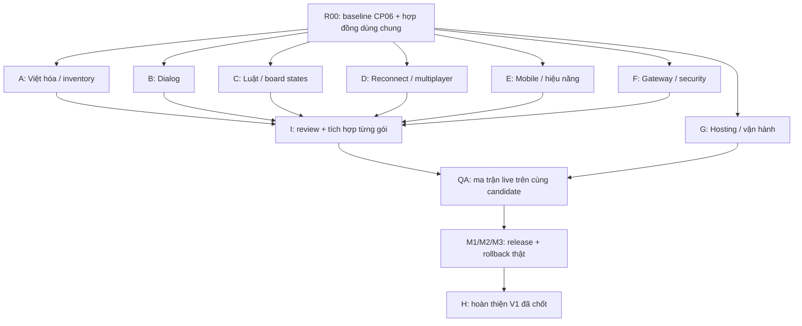

# Kế hoạch các chat độc lập từ CP06 đến hoàn tất TQS Mobile

> Lập ngày 11/10/2026, đã chỉnh theo yêu cầu: mỗi đầu việc có một chat riêng do người dùng mở; không dùng subagent. Chưa tạo chat/nhánh/worktree hoặc chạy test/deploy mới.

## 1. Định nghĩa hoàn tất

Phạm vi nền là `new_heg_mode`, FreeKill và ba package đúng revision đang pin. Luật và thông tin được phép xem vẫn do Lua/server quyết định. Không sửa TQSShop, không tự nâng upstream hoặc chỉnh server để tạo kết quả test thuận lợi.

| Mốc | Điều kiện đóng | Những phần còn thiếu tại CP06 |
| --- | --- | --- |
| **M1 — bot trên mobile** | T01–T09 phù hợp phạm vi P0 PASS; thao tác thủ công bài/skill/dialog trên điện thoại thật, GameOver và về sảnh; Việt hóa các luồng đã công bố | GAME-03A/03C live, board states live, Việt hóa, thiết bị thật; các ván Trust không chứng minh mọi thao tác thủ công |
| **M2 — multiplayer/mobile hoàn chỉnh** | M1 + T10–T12 PASS, hai tài khoản/thiết bị hoàn tất trận, reconnect đúng khả năng server; không lộ bài kín hoặc reply trùng | Hai người, reconnect, network lifecycle, mobile QA; dialog và kỹ năng chưa được phủ |
| **M3 — release ổn định** | M2 + T13–T15 PASS, HTTPS/WSS trên host độc lập Mac, thử mạng di động, restart/rollback/monitoring/quota; security đã xử lý | G7, SSH/hosting, gateway hardening, dependency audit, đo hiệu năng/vận hành |
| **M4 — V1 mở rộng** | M3 + checklist P2 được chốt và nghiệm thu: assets/polish, chat/spectator/replay nếu upstream hỗ trợ, tối ưu/canary nếu được chọn | G8 và tính năng V1 chưa được nghiệm thu; chưa mặc định mọi tính năng tùy chọn đều có |

`PLAYABLE_MOBILE=true` chỉ khi đạt định nghĩa trong master plan: bot + hai người trên mobile/web có bằng chứng, không sai luật/lộ bài kín/lỗi request nghiêm trọng, URL HTTPS/WSS sử dụng được từ mạng di động. Biến này không tự chứng minh M3/M4.

Muốn tuyên bố hoàn tất **toàn bộ bể đang bật**, phải có inventory dialog/kỹ năng theo package pin và coverage tương ứng. Nếu một pack còn tương tác bắt buộc chưa hỗ trợ, giữ ticket mở hoặc công bố rõ phạm vi release hẹp hơn; không gắn nhãn toàn bộ đã hỗ trợ chỉ vì vài ván ngẫu nhiên hoàn tất. Không tuyên bố mọi revision upstream tương lai đã tương thích.

## 2. Công việc có thể chạy song song

G0–G7 là các gate nghiệm thu có phụ thuộc, không bắt buộc mọi công việc triển khai phải làm tuần tự. CP06 đã có nền login/room/Lua/bot để mở các nhánh dưới đây cùng lúc.

Có thể thiết kế reconnect khi dialog chưa hoàn tất; có thể chuẩn bị hosting khi giao diện còn sửa. Nghiệm thu cuối phải chạy trên **một candidate đã tích hợp**, vì kết quả từ các branch khác nhau không cộng lại thành PASS của release.

## 3. Bảng giao việc

`I` là chat C00 điều phối/tích hợp. A–H chỉ là nhóm chuyên môn để đọc bảng; mỗi gói L01/L02/D01/.../V01 được giao cho một chat riêng, không gộp worker hoặc dùng subagent. R00 và Q01 là hai giai đoạn của cùng nhiệm vụ điều phối ở C00. Cột file dưới đây tính từ repository root.

| Gói | Agent | Công việc cụ thể | Phạm vi ưu tiên | Bắt đầu/phụ thuộc | Bàn giao và điều kiện nhận |
| --- | --- | --- | --- | --- | --- |
| **R00** | I | Chuẩn bị baseline đầy đủ CP06, chia ownership, hợp đồng event/request và lịch live test | Archive CP06, manifest/hash, tài liệu điều phối | Làm trước mọi nhánh code | Các môi trường nhận cùng source/runtime; xác minh build baseline; giữ nguyên checkout đang có thay đổi |
| **L01** | A | Dịch `祸水`/`礼下`; kiểm tên pack, tướng, skill, prompt, luật và log các bể đang bật | `engine/vietnamese.ts`, `engine/displayText.ts`; test riêng về dịch | Sau R00; không chờ B/C/D | Đúng variant Lua pin; không còn lỗi đã biết; audit riêng và Lua/DOM regression; giữ wire IDs/hidden data |
| **L02** | A + I | Lập inventory chuỗi/tương tác và coverage theo pack; đọc ngữ nghĩa các ca Kỳ Trân/lập quốc/Quyết chiến | Tài liệu coverage và evidence, không sửa JSON gốc | Song song L01; B/C cung cấp inventory request/skill | Phân biệt đã test local/live/chưa test; không dùng regex làm bằng chứng mọi luật đúng |
| **D01** | B | Đóng GAME-03A: bài tay úp, trang bị công khai, multi/Poxi, xem bài, lấy/bỏ bài | `CardSelectionPanel.tsx`, `CardsAndChoicePanel.tsx`, `ChoicePanel.tsx`; engine selection | Sau R00; live sau tích hợp | Native validation/reply đúng; stale/expiry/duplicate PASS; server thật nhận lựa chọn và ván tiếp tục |
| **D02** | B | Inventory và hoàn thiện dialog còn thiếu: AG, Guanxing, Exchange, Yiji, LuckCard, CustomDialog theo package thực tế | Module/component/test mới riêng từng dialog | Inventory làm ngay; implementation theo mức chặn trận | Có mapping command → snapshot → UI → validation → reply; không còn request bắt buộc chưa hỗ trợ trong phạm vi công bố |
| **R01** | C | Đóng GAME-03C: Thiểm/Đào, HP âm/cứu nhiều lần, Đào ảo/chuyển hóa, Quyết chiến/lập quốc | `GameplayControls.tsx`, `gameplayInteraction.ts`; fixtures riêng | Sau R00; phối hợp B nếu cùng dialog | Luật khớp Lua pin, server nhận reply; HP/hand cập nhật từ server; cả hủy/hết hạn và ca hợp lệ |
| **R02** | C | Bổ sung live cho GAME-03B; rà kỹ năng còn thiếu trong bể công bố | `GameBoardScreen.tsx`, `boardState.ts`, `gameplayState.ts`; patch bridge qua I | Có thể song song R01; tránh trùng E ở board | Xích/úp mặt/reveal/zone/HP đúng, không lộ tướng/bài/marks kín; có coverage và trace công khai phù hợp |
| **N01** | D | Thiết kế/triển khai reconnect theo protocol thực; lifecycle tab/network/room, backoff và hủy callback cũ | `connection.ts`, `connectionMessages.ts`, `gameAdapter.ts`; network tests | Sau R00; thống nhất event/store với I | T12 PASS; khôi phục đúng nếu server giữ phiên, báo kết thúc rõ nếu không; không reply trùng/stale hoặc false online |
| **N02** | D + I | Hai clients/tài khoản: create/join/ready/turn/full game; kiểm chéo state và privacy | E2E multiplayer riêng; API room/lifecycle | Harness làm song song; live candidate sau B/C/D | T10 PASS trên server thật; T11/T12 phối hợp E; không dùng một tài khoản cho hai clients |
| **M01** | E | QA iOS/Android thật, dọc/ngang, safe-area, touch/scroll/dialog; PWA nền; đo tải/bộ nhớ/chậm renderer | `styles.css`, `index.html`, `public/`, styles riêng; thay board JSX phối hợp C/I | Audit/layout/harness làm ngay; sửa/test trên candidate tích hợp | T11 PASS; người chơi thao tác thủ công; video/ảnh + device/OS/browser; số đo thật, không coi Chrome 390px là điện thoại |
| **S01** | F | Gateway Origin, bind/proxy trust, traversal/symlink, kích thước/queue/backpressure, flood/rate, cache/bundle revision; audit privacy/dependency | `game/gateway/**`; dependency change qua I | Sau R00; song song mọi UI | T14/T15 và gateway tests PASS; không đổi wire protocol; assess `node-forge` theo đường code thực; rủi ro release được xử lý/ghi rõ |
| **O01** | G | Chuẩn bị và triển khai hosting độc lập Mac; HTTPS/WSS, service supervision, logs/metrics, restart/rollback, quota | Thư mục deploy web/gateway riêng, runbook; không sửa server game/TQSShop | Config/container/service làm ngay; deploy cần quyền truy cập host; nhận S01 và artifact candidate | T13 PASS, URL ổn định, test 4G và rollback thật; giữ nguyên FreeKill; không claim xong khi chỉ Quick Tunnel |
| **Q01** | I + E | Chạy ma trận hợp nhất M1/M2/M3, đóng bug và tạo archive/release evidence | Harness dùng chung, coverage, CODEX_STATE/PLAN, release manifest | Sau từng gói local PASS và tích hợp; host ổn định trước nghiệm thu mạng cuối | T01–T15 phù hợp phạm vi PASS trên cùng source/artifact; không P0/P1 chặn release; khôi phục archive/rollback verified |
| **V01** | H hoặc agent rảnh | Hoàn thiện V1: asset hình/âm thanh, mô tả/animation, chat/spectator/replay nếu supported, performance/canary đã chọn | Module riêng/feature flag; upstream capability audit trước | Inventory/thiết kế làm sớm; ghép sau M3 hoặc khi không ảnh hưởng đường găng | Checklist V1 hữu hạn được chốt; từng feature có regression/live thích hợp; không mở scope vô hạn |

## 4. Baseline và quyền sửa file

**Không tạo worktree từ HEAD rồi coi đó là CP06.** HEAD hiện vẫn là `5005d7c`, nhiều thay đổi CP06 còn modified/untracked. Worktree từ HEAD không có toàn bộ code đã nghiệm thu.

R00 dùng mặc định: kiểm checksum archive CP06, giải nén riêng cho từng agent ở thư mục làm việc độc lập với checkout gốc, cài dependencies riêng trong `source/game/web` và `source/game/gateway`, giữ runtime pin riêng; ghi manifest/hash ban đầu. Đính kèm AGENTS.md và bản hiện hành của tài liệu phân công/CODEX_STATE/CODEX_PLAN cho từng agent, vì archive CP06 được tạo trước kế hoạch này; ghi riêng hash source nền và tài liệu hướng dẫn bổ sung. Agent giao **patch/delta so với baseline**, không giao nguyên cả repository hoặc toàn bộ dirty diff. Tài liệu checkpoint trong archive có thể cũ hơn ghi chú xác minh cuối; đối chiếu CODEX_STATE/PLAN hiện hành.

Nếu chủ repository đã cho phép tạo baseline commit, I có thể chuẩn bị một commit nền hoàn chỉnh đã review, rồi dùng managed worktree/branch `codex/<goi-viec>` từ commit đó. Kế hoạch này tự nó không cho phép commit những thay đổi cũ của người dùng. Không copy `.env`, credentials hoặc node_modules vào archive/patch.

| File/hạng mục dễ va chạm | Quy tắc |
| --- | --- |
| `engine/hostLua.ts`, `luaRuntime.ts`, `store/gameStore.ts` | I sở hữu tích hợp. B/C/D/F gửi patch cục bộ + hợp đồng event, I áp theo thứ tự và review |
| `GameBoardScreen.tsx` | C sở hữu logic state; E sở hữu layout/CSS; I ghép patch JSX khi cùng vùng |
| `vietnamese.ts`, `displayText.ts` | A sở hữu. B/C cung cấp key, source pin và nghĩa luật cho A |
| `connection.ts`, `gameAdapter.ts` | D sở hữu lifecycle. B/C gửi nhu cầu method/event cho D/I |
| `App.tsx`, package manifests/lockfiles | I sở hữu tích hợp; tránh mỗi agent tự nâng dependency |
| `real-lua-e2e/{harness,run}.ts*`, `live-gateway-e2e/run.ts`, tests tổng hợp | I sở hữu runner dùng chung; agent viết case/module riêng và đề xuất đăng ký |
| `CODEX_STATE.md`, `CODEX_PLAN.md` | Chỉ I cập nhật trạng thái chung; agent ghi report riêng |

Chạy độc lập vẫn được sửa file dùng chung **trong bản copy riêng**, nhưng phải giao patch nhỏ và báo rõ phần chạm hợp đồng; không cho nhiều agent ghi đồng thời vào cùng checkout.

## 5. Live tests và tài nguyên dùng chung

- CP06 đang public phải giữ đóng băng; build mới dùng candidate/port/process riêng. Không HMR, restart gateway hoặc reload tab người dùng giữa ván.
- CP06 đã có một tài khoản test private. Trước khi chạy nhiều clients, cần chuẩn bị thêm tài khoản test được phép dùng; không đổi tài khoản/IP để vượt temp-ban. Không ghi credentials vào prompt/report/source/log/ảnh.
- Một tài khoản chỉ có một phiên test tại một thời điểm. I cấp lịch live; dù có nhiều account, cùng IP vẫn có nguy cơ temp-ban, nên các test mất mạng/reload/kick phải tách khỏi live smoke thường.
- Local unit/fixture/browser ở port tự cấp có thể chạy song song. Live gameplay được lập lịch, không cho các agent tự chạy chung account hoặc tranh gateway/user tab.
- D/E chuẩn bị kịch bản gián đoạn trên môi trường test phù hợp, xác minh semantics server trước. Không cố tình làm rơi ván production rồi dùng kết quả đó để kết luận reconnect không hoạt động.
- Hardware iOS/Android và truy cập hosting là tài nguyên bên ngoài. Khi chưa có, agent vẫn hoàn tất code, harness và báo cáo local; trạng thái hardware/hosting live giữ `PENDING`.

## 6. Thứ tự các đợt và checkpoint

| Đợt | Việc chạy song song | Điều kiện chuyển đợt |
| --- | --- | --- |
| **0 — R00** | I chuẩn bị baseline; G kiểm quyền truy cập host; E xác định thiết bị; A/B/C kiểm inventory | Có cùng baseline/runtime/hash, ownership và lịch account/test |
| **1 — triển khai** | A: L01/L02; B: D01/D02; C: R01/R02; D: N01 + harness N02; E: M01; F: S01; G: O01 config | Từng gói có patch, local checks, evidence và giao diện event rõ |
| **2 — tích hợp theo gói** | I review/ghép A rồi B/C rồi D; F có thể ghép độc lập; E rebase layout lên candidate; G dựng host staging | Sau mỗi thay đổi shared bridge/store, chạy kiểm tra liên quan; tạo CP07/CP08 theo gói đã đạt, không theo số agent báo xong |
| **3 — nghiệm thu M1** | Manual bot/gameplay/dialog/rules live; E kiểm thiết bị; A kiểm text cùng các ván | M1 PASS; còn lỗi phát hiện trả đúng owner rồi chạy lại phần bị ảnh hưởng |
| **4 — nghiệm thu M2** | Hai account/two devices; reconnect/network lifecycle; privacy cross-client | T10–T12 PASS trên candidate tích hợp; có video/log đủ |
| **5 — release M3** | Host stable + security + 4G; restart/rollback/quota/metrics; archive phục hồi | T13–T15 và release checklist PASS; gắn source/runtime/dist hashes, cập nhật gate và bàn giao |
| **6 — đóng V1** | H/agent rảnh triển khai checklist P2 đã chốt; I tích hợp từng feature | M4 PASS cho danh sách hữu hạn đã công bố |

Các đợt mô tả thứ tự **nghiệm thu**. G chuẩn bị hosting từ đợt 0/1, E làm mobile từ đợt 1; không cần đợi M1 mới bắt đầu các việc này. Có thể phát hành bot ổn định sau M1 + điều kiện hosting/security tương ứng, rồi phát hành multiplayer sau M2/M3; phải ghi đúng phạm vi release.

## 7. Checklist đóng toàn bộ phạm vi đã chốt

- [ ] R00: baseline đầy đủ, hash/version đồng nhất, checkout gốc không bị ghi đè.
- [ ] Inventory enabled packs và request/skill/dialog; mỗi mục có owner + mức coverage local/live.
- [ ] Việt hóa tên/luật/prompt/log trong phạm vi công bố; lỗi đã biết và lỗi mới được xử lý hoặc giới hạn release được ghi rõ.
- [ ] Manual Sát/Thiểm/Đào, target, active/view-as/reveal, timing và request lifecycle được server nhận.
- [ ] Card-chosen/Poxi/AG và mọi dialog bắt buộc của phạm vi công bố không làm kẹt trận; Guanxing/Exchange/Yiji/CustomDialog được phủ khi package dùng.
- [ ] Self/opponent/HP/xích/úp mặt/zone/marks đúng quyền; không lộ thông tin kín ở DOM, store, network log hoặc evidence.
- [ ] Bot game và two-client game hoàn tất GameOver/result/về sảnh trên candidate tích hợp.
- [ ] iOS Safari và Android Chrome vật lý: dọc/ngang, touch/scroll/dialog, background/foreground, Wi-Fi/4G.
- [ ] Reconnect và session kết thúc phù hợp server; không stale/duplicate reply, timer/observer/socket leak hoặc false online.
- [ ] Gateway Origin/traversal/symlink/frame limit/backpressure/rate và immutable bundle semantics; audit dependency/privacy hoàn tất.
- [ ] Host độc lập Mac, HTTPS/WSS, service restart/reboot, monitoring/quotas và lỗi mạng rõ ràng.
- [ ] Thử rollback thật và restore archive; không tự nâng upstream hoặc đổi MD5 giữa phiên.
- [ ] Đo tải đầu, phản hồi UI, Lua/renderer/memory và tải gateway với ngưỡng công bố dựa trên dữ liệu; điều tra khoảng chậm renderer nếu tái hiện.
- [ ] Không còn lỗi P0/P1 chặn phạm vi release; P2 ngoài phạm vi được ghi backlog.
- [ ] Checklist V1 hữu hạn: features supported đã chọn có nghiệm thu; features không supported có kết luận và phạm vi rõ.
- [ ] Release report gắn commit/baseline hash, package pin, URL, device/browser, thời điểm, lệnh, PASS/FAIL và giới hạn.

T01–T15 lấy định nghĩa từ master plan; T16 chỉ bắt buộc nếu chọn Render canary. Các mục không áp dụng phải ghi lý do và phạm vi, không tự gắn PASS.

## 8. Cách mở và giao các chat

Người dùng mở chat C00 trước để chuẩn bị baseline. Sau khi nhận BASELINE.json và đường dẫn workspace, mở mỗi chat chuyên trách bằng prompt tương ứng tại [CHAT_TASK_PROMPTS.md](./CHAT_TASK_PROMPTS.md). Không dùng subagent trong bất kỳ chat nào; từng chat tự thực hiện nhiệm vụ được giao. Chat chuyên trách không tự tạo chat hoặc mở rộng sang gói khác.

Mỗi chat đọc `scratch/coordination/CP06/BASELINE.json` trong repository gốc để lấy workspace riêng, runtime và hashes. C00 tạo manifest này ở R00; chưa có manifest thì chat hoàn tất phần đọc/audit độc lập và báo thiếu nền, không sửa checkout gốc. C00 chuẩn bị các đường dẫn báo cáo/patch theo task ID và bản baseline nguyên vẹn để so delta.

Bàn giao mỗi task gồm `HANDOFF.md`, patch/delta, changed-file hashes và kết quả kiểm thử đã làm sạch tại đường dẫn được C00 cấp. Report phân biệt `LOCAL_PASS`, `LIVE_PENDING`, `READY_FOR_INTEGRATION`, `ACCEPTED`; chat chuyên trách không tự chuyển ticket chung thành PASS sau local test.

Các chat không tự nhìn thấy đầy đủ lịch sử nhau. C00 đọc artifacts để review/ghép; người dùng chuyển link báo cáo hoặc cho phép C00 đọc/gửi chỉ dẫn tới các chat có ID cụ thể. Không mặc định thông tin tự đồng bộ hoặc tự gửi tin khi chưa được người dùng cho phép.

## 9. Danh sách chat và thứ tự mở

| Chat | Gói | Đầu việc | Thời điểm mở |
| --- | --- | --- | --- |
| **C00** | R00 + Q01 | Baseline, ownership, lịch live, review/ghép và release | Mở đầu tiên; giữ chat này xuyên suốt |
| **C01** | L01 | Việt hóa và sửa chuỗi đã biết | Sau baseline |
| **C02** | L02 | Inventory/coverage theo package | Có thể audit ngay; nhận kết quả các chat khác để hoàn thiện |
| **C03** | D01 | Hoàn tất dialog chọn/xem bài | Sau baseline |
| **C04** | D02 | Dialog bổ sung AG/Guanxing/Exchange/Yiji/CustomDialog | Inventory làm sớm; code phối hợp interface của C03 |
| **C05** | R01 | Cứu Đào, view-as, Quyết chiến/lập quốc | Sau baseline |
| **C06** | R02 | Trạng thái bàn và privacy | Sau baseline; phối hợp shared store với C05 |
| **C07** | N01 | Reconnect/session lifecycle | Sau baseline |
| **C08** | N02 | Hai clients và multiplayer E2E | Harness làm sớm; live trên candidate C00 đã ghép |
| **C09** | M01 | Mobile/PWA/hiệu năng | Audit làm sớm; hardware QA trên candidate |
| **C10** | S01 | Gateway/security/dependency | Sau baseline |
| **C11** | O01 | Hosting/monitoring/rollback | Chuẩn bị sớm; deploy cần quyền host và artifact đã kiểm |
| **C12** | V01 | Hoàn thiện V1 đã chốt | Inventory sớm; code/release sau hoặc độc lập đường găng |
| **C13** | F01 | Kiểm toán nghiệm thu cuối độc lập, trả findings cho C00 | Sau khi có candidate tích hợp và coverage hiện hành |

Có 1 chat điều phối, 12 chat triển khai/coverage và 1 chat kiểm toán cuối; không cần chạy đồng thời cả 14 chat. Mở theo phụ thuộc và tài nguyên; local ở môi trường riêng có thể song song, live test cần lịch. C13 kiểm đúng candidate đã ghép và bàn giao PASS/FAIL/PENDING/N_A cùng findings; C00 review kết quả và chốt release. Nếu tách V01 thành feature nhỏ hơn, mỗi feature được chốt thành task/chat mới với hợp đồng bàn giao tương tự.

Chưa đặt ngày hoàn thành hoặc hệ số tăng tốc. C00 ước lượng lại sau R00 và đợt bàn giao đầu dựa trên coverage còn thiếu, quyền hosting, hardware và test thật. Kết quả từ các chat phải được kiểm lại trên cùng candidate sau ghép.
