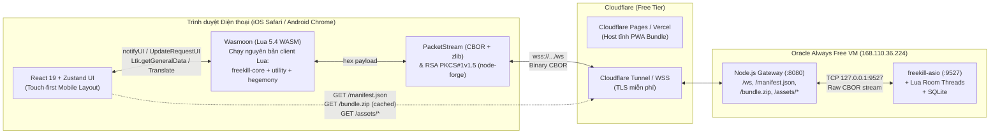

# Kế Hoạch Tổng Thể: TQS Mobile Web Client (Trên Nền FreeKill / Hegemony)

> **Mục tiêu cốt lõi:** Xây dựng bản Web Client **Mobile-First (100% tập trung trình duyệt di động)**, **miễn phí vận hành (Free-tier)**, **bỏ qua hoàn toàn việc phát triển/duy trì client FreeKill native (Qt/QML)**, nhưng **tái sử dụng nguyên vẹn 100% logic Lua** (`freekill-core`, `utility`, `hegemony`) và server C++ (`freekill-asio`) đang chạy trên Oracle Always Free VM.

---

## 1. Báo Cáo Tiến Độ Hiện Tại (As of 2026-10-09)

### 1.1. Những việc đã hoàn thành
1. **Khảo sát kiến trúc & mã nguồn Upstream (`qsgs-fans` trên Gitee & GitHub):**
   - Đã clone đầy đủ 4 repo vào thư mục tạm (`scratch/upstream`):
     - `freekill-asio` (78 files C++): Đã giải mã hoàn toàn lớp mạng TCP, đóng gói CBOR (`PacketBuilder`, `Router`), cơ chế nén `qUncompress` (4-byte big-endian size header + zlib), cơ chế `Heartbeat` (30s TTL), thuật toán tính `flist.txt` MD5 (chuẩn hóa `\r\n` $\to$ `\n`), và quy trình xác thực RSA (`NetworkDelayTest` $\to$ `Setup` với 32-byte AES prefix + mật khẩu mã hóa `RSA_PKCS1_PADDING`).
     - `freekill-core` (307 files Lua, 188 files QML): Đã phát hiện toàn bộ state machine phía client, giải mã CBOR nội bộ, kiểm tra hợp lệ khi chọn bài/mục tiêu/kỹ năng (`ActiveSkill`, `ViewAsSkill`, `CardSkill`, `poxi`, `choose_general_rule`...) đều nằm trong **Lua client** (`lua/client/*`, `ltk/client/*`), giao tiếp với tầng hiển thị qua một cổng duy nhất là `FClient:notifyUI(command, data)` và các hàm helper (`UpdateRequestUI`, `FinishRequestUI`, `Translate`, `Ltk.*`). Có sẵn file ngôn ngữ tiếng Việt `lua/client/i18n/vi_VN.lua` (650 dòng).
     - `utility` (24 files Lua, 23 files QML) & `hegemony` (477 files Lua, 5 files QML, kèm thư mục `image/`, `audio/`, `i18n/`).
2. **Xây dựng Gateway (`game/gateway/`):**
   - Đã tạo [`game/gateway/package.json`](../../game/gateway/package.json) và [`game/gateway/src/server.mjs`](../../game/gateway/src/server.mjs), cài đặt xong dependencies (`ws`, `fflate`).
   - Chức năng của Gateway:
     - Cầu nối **WebSocket (`/ws`) $\leftrightarrow$ TCP (`127.0.0.1:9527`)** giữ nguyên luồng byte CBOR tự phân tách (self-delimiting), kèm keep-alive ping 30s và giới hạn kết nối theo IP.
     - Endpoint **`/manifest.json`**: Đọc trực tiếp `flist.txt` của `freekill-asio` để cấp đúng mã `md5` mà server yêu cầu khi login, kèm danh sách packages và hash của bundle.
     - Endpoint **`/bundle.zip`**: Tự động gom và nén toàn bộ các file `.lua` và `.json` từ các gói đang bật trên server (`freekill-core`, `utility`, `hegemony`) để trình duyệt tải 1 lần và cache vĩnh viễn theo hash (`immutable`).
     - Endpoint **`/assets/*`**: Phục vụ trực tiếp ảnh tướng, ảnh lá bài, icon và âm thanh từ thư mục `packages/` của server với header cache dài hạn.
3. **Xây dựng Lõi Engine cho Web Client (`game/web/`):**
   - Đã tạo [`game/web/package.json`](../../game/web/package.json) và cài đặt xong 80 packages (`react`, `zustand`, `wasmoon` — Lua 5.4 WebAssembly, `node-forge` — mã hóa RSA PKCS#1 v1.5, `fflate`, `vite`, `typescript`).
   - Đã viết [`game/web/src/engine/packet.ts`](../../game/web/src/engine/packet.ts): Bộ đóng gói và giải mã luồng `PacketStream` CBOR (4-tuple Notification/Reply và 6-tuple Request), tự động giải nén `COMPRESSED (0x1000)` bằng `fflate.unzlibSync`.
   - Đã viết [`game/web/src/engine/hostLua.ts`](../../game/web/src/engine/hostLua.ts): Lớp giả lập toàn bộ C++/Qt bindings (`fk.*`, `fk.Client`, `fk.Player`, `fk.Backend`, `fk.QList`) bằng Lua thuần để chạy nguyên bản code Lua của FreeKill bên trong WebAssembly mà không cần sửa bất kỳ file Lua nào của upstream.
   - Đã viết [`game/web/src/engine/luaRuntime.ts`](../../game/web/src/engine/luaRuntime.ts): Khởi tạo máy ảo Lua 5.4 (`wasmoon`), mount toàn bộ 808 files `.lua`/`.json` vào filesystem ảo `/fk`, nạp `lua/freekill.lua` và `lua/client/client.lua`.
   - Đã viết [`game/web/src/engine/connection.ts`](../../game/web/src/engine/connection.ts): Quản lý kết nối WebSocket, tự động trả lời `Heartbeat`, xử lý bắt tay `NetworkDelayTest` $\to$ mã hóa RSA `Setup`, và chuyển tiếp gói tin giữa Server $\leftrightarrow$ Lua VM $\leftrightarrow$ React UI.
   - Đã viết [`game/web/scripts/smoke.ts`](../../game/web/scripts/smoke.ts): Script kiểm thử tự động trên Node.js.

### 1.2. Vấn đề đang dừng lại ở bước Smoke Test vừa rồi
- Khi chạy thử `npx tsx scripts/smoke.ts`, quá trình nạp 808 files vào `wasmoon` gặp lỗi nhỏ tại [`game/web/src/engine/luaRuntime.ts`](../../game/web/src/engine/luaRuntime.ts) dòng 61:
  - **Nguyên nhân:** Phiên bản Emscripten FS đóng gói trong `wasmoon@1.16.0` không mở hàm `FS.analyzePath()`, hoặc cần dùng API `factory.mountFileSync(wasm, path, content)` / `try { fs.mkdir(dir) } catch {}` thay cho `fs.analyzePath(dir).exists`.
  - **Cách khắc phục (chỉ ~5 dòng code ở bước kế tiếp):** Dùng `try { fs.stat(p) } catch {}` cho `exists`/`mkdirp` hoặc dùng `factory.mountFileSync`.

---

## 2. Kiến Trúc Tổng Thể (Mobile Web-Only, 0đ Chi Phí)



### Tại sao chạy cả Lua Client trên trình duyệt bằng WebAssembly (`wasmoon`) là chìa khóa quyết định?
Nếu chỉ viết UI React nói chuyện trực tiếp với Server mà **không** chạy Lua client trên trình duyệt, ta sẽ phải viết lại bằng TypeScript hơn **800 file Lua** xử lý:
- Luật chọn bài hợp lệ (`cardFilter`), luật chọn mục tiêu (`targetFilter`), khoảng cách tấn công, giới hạn số mục tiêu, chuyển đổi bài (`ViewAsSkill`).
- Luật chọn tướng Quốc Chiến (`hegemony` general pair matching,珠联璧合 / Companion, giới hạn thế lực).
- Hơn 20 loại hộp thoại đặc biệt (`poxi_methods`, `qml_marks`, `mini_games`, `target_tips`).

Khi nhúng `wasmoon` (~200 KB gzip) chạy trực tiếp bộ `freekill-core` + `utility` + `hegemony` trên trình duyệt:
- **95% logic khó nhất đã có sẵn:** Khi đến lượt người chơi, Lua client tự tính toán lá bài nào được phép bấm, nút kỹ năng nào sáng, mục tiêu nào hợp lệ, nút "Đồng ý / Hủy" có bấm được không, và phát sự kiện `UpdateRequestUI` cho React chỉ việc hiển thị!
- **Không bao giờ lệch luật giữa Client và Server:** Vì Client chạy chính xác file `.lua` được đóng gói từ `packages/` của Server qua `/bundle.zip`.

---

## 3. Đặc Tả Giao Thức Mạng (`freekill-asio`)

### 3.1. Khung gói tin CBOR (Packet Framing)
Mọi gói tin trên TCP (và qua `/ws`) là một mảng CBOR (4 hoặc 6 phần tử):

| Loại gói | Cấu trúc mảng CBOR | Giá trị `type` (Bitmask) |
|---|---|---|
| **Server $\to$ Client Notification** | `[-2, type, bytes(command), bytes(cborData)]` | `0x421` (`TYPE_NOTIFICATION \| SRC_SERVER \| DEST_CLIENT`), có thể kèm `0x1000` (`COMPRESSED`) |
| **Server $\to$ Client Request** | `[requestId, type, bytes(command), bytes(cborData), timeout, timestamp]` | `0x121` (`TYPE_REQUEST \| SRC_SERVER \| DEST_CLIENT`) |
| **Client $\to$ Server Notification** | `[-2, 0x412, bytes(command), bytes(cborData)]` | `0x412` (`TYPE_NOTIFICATION \| SRC_CLIENT \| DEST_SERVER`) |
| **Client $\to$ Server Reply** | `[requestId, 0x212, bytes(command), bytes(cborData)]` | `0x212` (`TYPE_REPLY \| SRC_CLIENT \| DEST_SERVER`) |

### 3.2. Quy trình Đăng nhập & Vào Sảnh (Handshake)
1. Client mở kết nối `/ws` $\to$ Gateway nối TCP tới `127.0.0.1:9527`.
2. Server gửi ngay `NetworkDelayTest` chứa khóa công khai RSA (`server/rsa_pub` mã hóa dạng CBOR byte string).
3. Client tạo chuỗi `32 ký tự hex ngẫu nhiên + utf8(password)`, mã hóa bằng RSA-PKCS#1-v1.5 với khóa công khai của Server, rồi gửi gói `Setup`:
   ```text
   command = "Setup"
   cborData = CBOR_Array([ username, rsa_cipher_bytes, server_flist_md5, "0.5.25", device_uuid ])
   ```
4. Nếu `md5` khớp với `flist.txt` và mật khẩu đúng (tự động đăng ký nếu tên tài khoản chưa tồn tại), Server phản hồi lần lượt:
   - `Setup`: `[playerId, screenName, avatar, serverTimestampMs]`
   - `SetServerSettings`: `[motd, hiddenPacks, enabledFeatures]`
   - `AddTotalGameTime`: `[playerId, seconds]`
   - `EnterLobby`: `""`

### 3.3. Nhóm lệnh Sảnh (Lobby) & Phòng chờ (Waiting Room)
- **Từ Client gửi lên (`notifyServer`):**
  - `RefreshRoomList`: Làm mới danh sách phòng.
  - `CreateRoom`: `cbor.encode([roomName, capacity, timeout, settingsMap])` (Ví dụ Quốc Chiến: `gameMode = "new_heg_mode"`, `generalNum = 5`, `enableFreeAssign = false`...).
  - `EnterRoom`: `cbor.encode([roomId, password])`.
  - `ObserveRoom`: `cbor.encode([roomId, password])`.
  - `PushRequest`:
    - `"ready"` (Sẵn sàng / Hủy sẵn sàng)
    - `"start"` (Chủ phòng bắt đầu ván)
    - `"addrobot"` (Thêm Bot AI)
    - `"kick,<id>"` (Đuổi người chơi / Bot)
    - `"quit"` (Rời phòng về Sảnh)
    - `"reconnect"` (Tự động gửi khi kết nối lại vào phòng đang đánh)
  - `Chat`: `cbor.encode({ type = 1|2, msg = "..." })`.

### 3.4. Nhóm sự kiện Trong Ván Chơi (`notifyUI` từ Lua Client sang React)
Khi ván đấu diễn ra, Lua Client xử lý toàn bộ gói tin của Server, cập nhật trạng thái trong bộ nhớ Lua (`ClientInstance.players`, bài trên tay, bài trên bàn, trang bị, khu phán xét, kỹ năng, dấu ấn `mark`), rồi gọi `notifyUI(command, data)` sang React:

| Nhóm | Lệnh `notifyUI` chính | Vai trò trên giao diện Mobile |
|---|---|---|
| **Vòng đời ván** | `EnterRoom`, `AddPlayer`, `RemovePlayer`, `RoomOwner`, `ReadyChanged`, `StartGame`, `ArrangeSeats`, `GameOver` | Chuyển màn hình Phòng chờ $\leftrightarrow$ Bàn chơi, sắp xếp ghế ngồi quanh bàn, bảng kết quả thắng/thua |
| **Cập nhật trạng thái** | `PropertyUpdate`, `MoveCards`, `SetPlayerMark`, `SetBanner`, `AddSkill`, `LoseSkill`, `UpdateLimitSkill`, `SetCardFootnote` | Cập nhật máu (HP), thế lực Quốc Chiến (`kingdom`), trạng thái úp/lật tướng (`general`, `deputyGeneral`), số bài trên tay, vùng trang bị/phán xét, hiệu ứng rút/đánh bài |
| **Tương tác / Hỏi đáp (Request)** | `PlayCard`, `AskForUseActiveSkill`, `AskForUseCard`, `AskForResponseCard`, `CancelRequest`, `UpdateRequestUI` | Bật/tắt chế độ chọn bài trên tay, chọn mục tiêu, chọn kỹ năng; thanh đếm ngược thời gian; nút **Đánh / Xác nhận / Bỏ qua / Kết thúc lượt** |
| **Hộp thoại chuyên biệt** | `AskForGeneral`, `AskForChoice`, `AskForChoices`, `AskForCardChosen`, `AskForCardsChosen`, `AskForPoxi`, `AskForGuanxing`, `AskForExchange`, `AskForYiji`, `AskForLuckCard`, `CustomDialog` | Bottom-sheet / Modal trên mobile để: Chọn cặp tướng Quốc Chiến, chọn mục (Choice), rút bài đối phương (Thuận Thủ / Quá Hà), Quan Tinh, đổi bài đầu ván (Thẻ vận may), và các hộp thoại Poxi/Custom QML |
| **Thông báo & Nhật ký** | `GameLog`, `ShowToast`, `ServerMessage`, `Chat`, `Ltk.SkillInvoked`, `Emotion` | Dòng thông báo nhanh giữa bàn, lịch sử ván đấu (drawer trượt), hiệu ứng hô kỹ năng / sát thương |

---

## 4. Lộ Trình Triển Khai Chi Tiết (6 Giai Đoạn)

### Giai đoạn 1: Hoàn tất Lua WASM Runtime & Kiểm thử Kết nối Sống (Đang ở 90%)
- **Công việc còn lại:**
  1. Sửa hàm tạo thư mục FS trong [`game/web/src/engine/luaRuntime.ts`](../../game/web/src/engine/luaRuntime.ts) (thay `analyzePath` bằng `try { fs.stat(...) } catch` hoặc `factory.mountFileSync`).
  2. Chạy lại `npx tsx scripts/smoke.ts` để xác nhận:
     - 808 files của `freekill-core` + `utility` + `hegemony` boot thành công trong < 1.5 giây.
     - Hàm `Translate` (tiếng Việt `vi_VN` / tiếng Anh / tiếng Trung) và `GetGameModes` trả về đúng dữ liệu `new_heg_mode`.
  3. Chạy thử Gateway cục bộ trỏ vào server thật `168.110.36.224:9527` (hoặc lấy `md5` từ gói `UpdatePackage` khi server báo lệch MD5) để kiểm chứng đăng nhập, vào Lobby, tạo phòng Quốc Chiến và thêm Bot hoàn toàn từ code TypeScript + Wasmoon.

### Giai đoạn 2: Quản lý Trạng thái (Zustand Store) & Cầu nối Lua $\leftrightarrow$ React
- Thiết kế `useGameStore` (`game/web/src/store/gameStore.ts`):
  - Lưu trữ trạng thái kết nối (`booting` $\to$ `connecting` $\to$ `authenticating` $\to$ `lobby` $\to$ `room` $\to$ `in_game`).
  - Đồng bộ danh sách phòng (`UpdateRoomList`), thông tin người chơi trong phòng, trạng thái sẵn sàng.
  - Khi vào ván (`StartGame`), cung cấp hàm snapshot đọc trực tiếp trạng thái chuẩn từ `ClientInstance` trong Lua (danh sách ghế, tướng chính/tướng phó, máu, giáp, thế lực, bài trên tay `Self`, trang bị, khu phán xét, kỹ năng, marks) mỗi khi có `notifyUI` để UI React luôn đồng bộ 100% với Lua mà không sợ lệch state.
  - Chuẩn hóa bộ điều khiển Request (`pendingRequest`, `uiUpdate` từ `UpdateRequestUI`: danh sách bài được phép chọn, mục tiêu được phép chọn, nút OK/Cancel/End Phase).

### Giai đoạn 3: Giao diện Mobile — Đăng nhập, Sảnh (Lobby) & Phòng chờ
- Thiết kế UI chuyên biệt cho màn hình cảm ứng điện thoại (cả dọc và ngang, hỗ trợ PWA `manifest.webmanifest`, full-screen viewport `100dvh`, chống zoom/pull-to-refresh nhầm):
  1. **Màn Đăng nhập:** Nhập tên tài khoản + mật khẩu (tự động tạo tài khoản nếu mới), chọn ngôn ngữ (`Tiếng Việt` / `English` / `中文`), thanh tiến trình tải & giải nén `bundle.zip` (lưu cache IndexedDB/Cache API).
  2. **Màn Sảnh (Lobby):**
     - Danh sách phòng đang mở, nút vào nhanh.
     - Nút **Tạo phòng Quốc Chiến (Hegemony)** 1 chạm với cấu hình chuẩn (`new_heg_mode`, số người 2–8, số tướng chọn 5–7, thời gian suy nghĩ, bật/tắt Bot).
     - Khung chat sảnh và số người đang online.
  3. **Màn Phòng chờ (Waiting Room):**
     - Hiển thị các ghế trong phòng, nút **+ Thêm Bot AI**, nút **Sẵn sàng**, nút **Bắt đầu ván** (cho chủ phòng), nút **Rời phòng**.

### Giai đoạn 4: Giao diện Bàn Chơi Mobile (Core Gameplay)
- Bố cục tối ưu cho màn hình điện thoại:
  1. **Thanh thông tin trên cùng:** Số bài chồng rút, số vòng, thế lực còn lại, nút mở Nhật ký ván đấu (Log drawer), Chat, Đầu hàng / Kết nối lại.
  2. **Vùng đối thủ (Opponents Grid):** Các thẻ người chơi nhỏ gọn hiển thị:
     - Tướng chính & Tướng phó (hoặc trạng thái **Ẩn tướng / Úp** đặc trưng của Quốc Chiến), biểu tượng Thế lực (Ngụy / Thục / Ngô / Quần / Dã Tâm Gia), thanh máu + giáp, số bài trên tay, 4 ô trang bị (Vũ khí, Phòng cụ, +1, -1), biểu tượng khu phán xét (Lạc Bất Tư Thục, Binh Lương, Thiểm Điện) và các dấu ấn (`mark`).
     - Chạm giữ (long-press) vào bất kỳ tướng nào để xem chi tiết kỹ năng đã dịch tiếng Việt/Anh.
  3. **Vùng trung tâm (Table Pile & Toast):** Hiển thị các lá bài vừa đánh ra bàn, đường chỉ mục tiêu, thông báo hành động và thanh đếm ngược thời gian.
  4. **Vùng người chơi (`Self` Dashboard ở đáy màn hình):**
     - Chân dung Tướng chính & Tướng phó của bản thân, các nút **Kỹ năng** (chạm để kích hoạt kỹ năng chủ động / chuyển đổi, bao gồm cả kỹ năng **"Thế thân / Lật tướng"** trong Quốc Chiến).
     - **Khay bài trên tay (Handcard Area):** Vuốt ngang mượt mà, chạm 1 lần để chọn/bỏ chọn lá bài (những lá không hợp lệ theo tính toán của Lua sẽ tự làm mờ), chạm giữ để đọc mô tả lá bài.
     - **Thanh nút hành động:** **Xác nhận (Đánh)**, **Hủy / Bỏ qua**, **Kết thúc giai đoạn ra bài**.

### Giai đoạn 5: Các Hộp Thoại Tương Tác Đặc Thù (Modals / Bottom Sheets)
Chuyển đổi các hộp thoại QML quan trọng nhất của `freekill-core`, `utility`, và `hegemony` sang React Modal thân thiện với ngón tay trên điện thoại:
1. **Chọn Tướng Quốc Chiến (`GeneralCardDialog` / `AskForGeneral`):**
   - Hiển thị 5–7 tướng được chia, tự động gợi ý các cặp tướng cùng thế lực (kể cả đánh dấu cặp Châu Liên Bích Hợp / Companion bằng hàm `Ltk.canMatchInHegemony` và `Ltk.isCompanionWith`), chọn Tướng chính + Tướng phó.
2. **Chọn Mục (`ChoiceBox` / `ChoicesBox`):** Dùng khi kích hoạt kỹ năng nhiều lựa chọn hoặc chọn thế lực.
3. **Chọn Bài Của Người Khác (`PlayerCardBox` / `AskForCardChosen` / `AskForCardsChosen`):** Dùng cho Quá Hà Sái Kiều, Thuận Thủ Khiên Dương, Thiết Kỵ... (chọn bài trên tay, vùng trang bị, vùng phán xét).
4. **Hộp Thoại Đa Năng `PoxiBox` (`AskForPoxi`) & `AGBox` (Ngũ Cốc Phong Đăng):** Dùng lại trực tiếp các hàm `Ltk.poxiPrompt`, `Ltk.poxiFilter`, `Ltk.poxiFeasible` trong Lua để kiểm tra hợp lệ.
5. **Quan Tinh / Sắp xếp bài (`GuanxingBox`), Trao đổi bài (`ExchangeBox`), Chia bài (`YijiBox`), Thẻ vận may (`LuckCardBox`).**
6. **Cơ chế Fallback an toàn cho CustomDialog lạ:** Nếu một kỹ năng hiếm gọi `CustomDialog` chưa có component riêng, hiển thị hộp thoại thông minh cho phép chọn lựa chọn hợp lệ hoặc nút Bỏ qua để **không bao giờ bị kẹt ván đấu**.

### Giai đoạn 6: Triển khai Thực tế (Deployment) & Hoàn thiện Trải nghiệm Mobile
1. **Triển khai Gateway lên VM Oracle (`168.110.36.224`):**
   - Bổ sung systemd service `freekill-web-gateway.service` chạy `game/gateway/src/server.mjs` cạnh `freekill-native.service`.
   - Cấu hình Cloudflare Tunnel (`cloudflared`) hoặc Caddy/Nginx miễn phí để cung cấp địa chỉ `wss://` (bắt buộc khi web app chạy trên `https://`).
2. **Triển khai Web Client (Free Hosting):**
   - Build tĩnh `game/web/dist` và đưa lên Cloudflare Pages / Vercel / Firebase Hosting (hoặc phục vụ trực tiếp từ chính Gateway qua Cloudflare Tunnel để không tốn thêm dịch vụ nào).
3. **Kiểm thử End-to-End (E2E):**
   - Chơi trọn vẹn 1 ván Quốc Chiến với Bot AI trên giả lập di động.
   - Kiểm thử 2 trình duyệt điện thoại vào chung phòng, đánh hết ván, và kiểm thử **tự động kết nối lại (`reconnect`)** khi tắt/bật mạng 4G hoặc tải lại trang.

---

## 5. Cấu Trúc Thư Mục Dự Kiến Trong Repo `tqs`

Toàn bộ mã nguồn của game web được cô lập gọn gàng trong thư mục `game/`, **không làm ảnh hưởng đến Storefront `TQSShop` hiện tại**:

```text
tqs/
├── docs/
│   └── web-client/
│       └── WEB_CLIENT_PLAN.md      # Tài liệu kế hoạch & kiến trúc này
├── deploy/
│   └── freekill-native/            # Cấu hình server freekill-asio hiện hữu trên Oracle VM
└── game/
    ├── gateway/                    # Cầu nối WebSocket <-> TCP/CBOR + Bundle/Asset server
    │   ├── package.json
    │   └── src/
    │       └── server.mjs
    └── web/                        # Ứng dụng React Mobile Web Client (PWA)
        ├── package.json
        ├── index.html
        ├── vite.config.ts
        ├── tsconfig.json
        ├── scripts/
        │   └── smoke.ts            # Script kiểm thử Lua WASM + đăng nhập server thật
        └── src/
            ├── main.tsx
            ├── App.tsx
            ├── engine/
            │   ├── packet.ts       # CBOR framing + zlib decompression
            │   ├── hostLua.ts      # Giả lập C++/Qt bindings (fk.*, FClient, FPlayer)
            │   ├── luaRuntime.ts   # Wasmoon (Lua 5.4 WASM) loader & bridge
            │   └── connection.ts   # WebSocket + RSA Auth + Heartbeat + Request tracker
            ├── store/
            │   └── gameStore.ts    # Zustand state đồng bộ Lua Client <-> React UI
            └── components/
                ├── LoginScreen.tsx
                ├── LobbyScreen.tsx
                ├── WaitingRoomScreen.tsx
                ├── GameBoardScreen.tsx
                └── dialogs/        # GeneralChoose, ChoiceBox, CardChosen, PoxiBox, Guanxing...
```

---

## 6. Các Điểm Cần Bạn Review Trước Khi Chạy Tiếp

1. **Kiến trúc dùng `wasmoon` (Lua 5.4 WebAssembly) chạy nguyên bản Lua client của FreeKill trên trình duyệt:** Bạn có đồng ý giữ hướng này để đảm bảo 100% tướng/kỹ năng Quốc Chiến chạy đúng ngay lập tức mà không phải port tay hàng trăm file Lua sang JS không?
2. **Cách truy cập Server `168.110.36.224:9527`:**
   - Hiện tại bạn có sẵn quyền SSH vào VM Oracle `168.110.36.224` để cài `game/gateway` lên cùng máy với `freekill-asio` không, hay trong lúc phát triển bạn muốn chạy Gateway ngay trên máy Windows của bạn (Gateway trên máy bạn nối TCP tới `168.110.36.224:9527`)? *(Lưu ý: Cả 2 cách đều hoạt động được ngay lập tức vì Gateway có thể lấy danh sách commit package từ gói `UpdatePackage` của server).*
3. **Ngôn ngữ mặc định trên UI Mobile:** Bạn muốn ưu tiên hiển thị **Tiếng Việt (`vi_VN`)** mặc định (kèm fallback sang Tiếng Anh / Tiếng Trung cho những câu dịch còn thiếu trong gói `hegemony`), hay ngôn ngữ nào khác?
